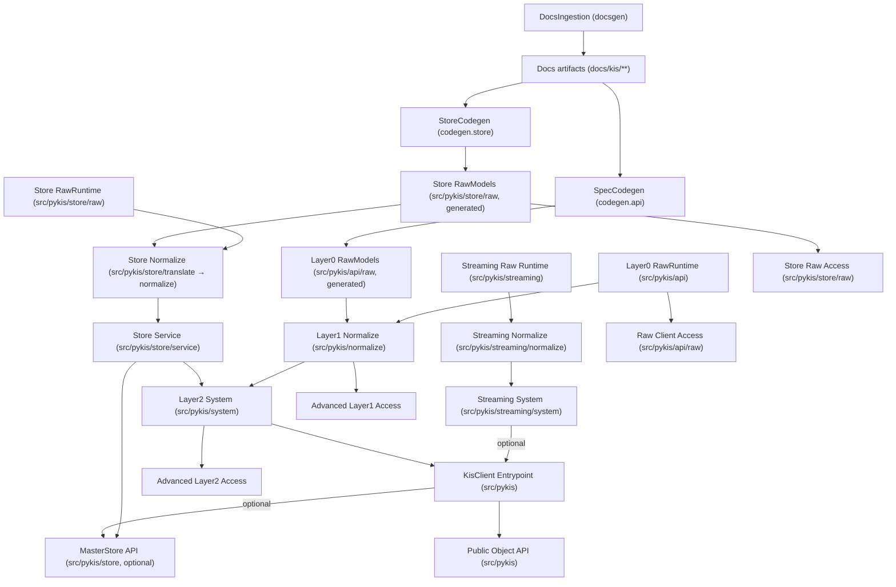
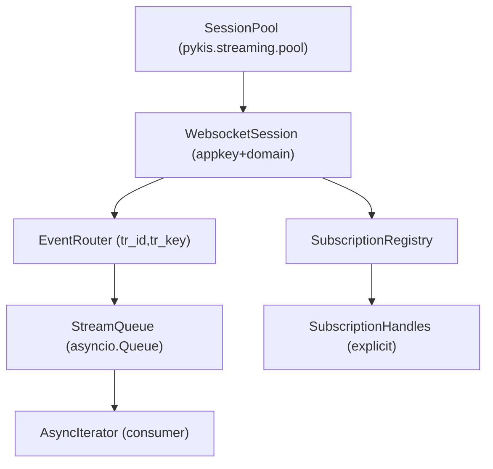

# Pykis Layered Refactor Plan

## AS‑IS assessment (layering + data model gaps)

- Build‑time tooling is already separated ([`src/docsgen`](src/docsgen), [`src/codegen`](src/codegen)), but runtime packages are mixed and partially duplicated.
- Raw runtime appears in both [`src/pykis/api`](src/pykis/api) and [`src/pykis/raw`](src/pykis/raw); a canonical namespace is not defined.
- Generated raw models live under [`src/pykis/api/raw`](src/pykis/api/raw) alongside runtime client code; generated vs hand‑written boundaries are not explicit.
- No repository code currently references a `codeagent` module or pipeline; its role vs `src/codegen` is undefined.
- 국내/해외 주식 API 형상이 크게 달라 **단일 SDK 형상**이 없고, 응답 노멀라이즈 레이어가 부재.
- **표준 영어 포맷/형상 통합** 파이프라인과 런타임 변환 레이어가 연결되어 있지 않음.
- Store 번역 유틸 ([`src/pykis/store/translate`](src/pykis/store/translate))도 도메인 표준 네이밍과 연결되지 않음.

### Store system (master data) — AS‑IS

- Store raw 계층은 [`src/pykis/store/raw`](src/pykis/store/raw)에 파서/스펙과 **generated structs/enums**가 함께 있어 런타임 유틸과 코드젠 산출물이 혼재됨.
- Store ingest 경로가 이원화되어 있음: sqlite snapshot 파이프라인 ([`store.service.pipeline`](src/pykis/store/service/pipeline.py))과 in‑memory 인덱스 빌더 ([`store.service.ingest`](src/pykis/store/service/ingest.py))가 다른 정규화 경로를 사용함.
- `translate` 계층의 `Instrument`/`FieldMapNormalizer`는 존재하지만 기본 `MasterStore` 경로는 raw 모델을 반환하고 Layer 1 정규화가 기본 API에 반영되지 않음.
- 인덱싱 규칙([`store.service.indexing`](src/pykis/store/service/indexing.py))이 raw 필드 휴리스틱에 의존하며, Layer 1 정규화 규칙과 연결되지 않음.
- Store 다운로드/스냅샷 생성 I/O가 공개 API (`pykis.store`)와 함께 노출되어 있어 런타임 표면에 빌드/툴링 성격이 섞임.
- Store codegen(`src/codegen/store`)은 `docs/kis/종목정보파일`(docsgen 산출물)을 입력으로 사용하지만, **docsgen → codegen.store** 연결이 플랜/그래프에 명시되어 있지 않음.

## Data model architecture (Layer 0 → 2)

### Layer 0 — Raw (doc‑based codegen)

- 입력: 문서/스펙 → codegen 산출물.
- 산출: 국내/해외 분리된 **Raw 모델** + Raw Client.
- 원칙: API 원형 보존, alias/extra 처리만, **형상 통합 없음**.
- 위치 제안: [`src/pykis/api/raw`](src/pykis/api/raw) + canonical runtime (auth/token/registry/client).

### Layer 1 — Normalize (codeagent + codex sdk + 표준 영어 포맷)

- 목표: **국내/해외 형상 통합** + **표준 영어 필드명**으로 정규화.
- 정규화 규칙 생성은 **빌드‑타임**에서 수행하고, 런타임은 결정적 매핑만 수행.
- 입력: codegen으로 자동 생성된 Layer 0 raw 모델.
- 방식: `codeagent`에 codex sdk 기반 AI agent를 구축하고 프롬프트를 통해 Layer 1 모델/매핑을 생성.
- 산출: `Normalized*` 모델 + 변환 규칙 (예: `src/pykis/normalize/mappings/*.py|yaml`).
- 소비자: 고급 기능/정규화 접근 사용자.

### Layer 2 — System (pykis 시스템 레이어)

- 목표: **단일 형상**으로 관리 + **누락 데이터 보정/계산** + **다중 API 병합**으로 데이터 품질 향상.
- 예: 수익률/변동률/요약 필드 계산, 여러 endpoint 응답 병합.
- 산출: 객체 기반 API (`KisClient`/`KisAsyncClient`) + 도메인 모델.
- 일반 사용자는 Layer 2 API를 기본 경로로 사용.

### Realtime/Streaming layering (Layer 0 → 2)

- **Layer 0 (Streaming Raw)**: websocket transport, 인증/세션/구독/복호화만 담당. 기본 경로는 파싱 후 Layer 1으로 전달되며, raw 접근은 명시적 Layer 0 API로만 제공.
- **Layer 1 (Streaming Normalize)**: 국내/해외 이벤트 형상 통합 + 표준 필드명으로 정규화. 기본 사용자 경로는 정규화 모델만 제공.
- **Layer 2 (Streaming System)**: 비즈니스 규칙/병합/파생 필드 계산을 적용한 이벤트 모델로 사용자 레이어에 제공.
- **원칙**: 기본 사용자 레이어는 Layer 2/1을 사용하며, raw 응답은 선택적 Layer 0 접근으로만 제공.

### Store pipeline placement (Layer 0 → 2)

- **Layer 0 (Store Raw)**: `codegen.store`(`src/codegen/store`)가 `docs/kis/종목정보파일`(docsgen 산출물)을 읽어 `src/pykis/store/raw/structs`, `src/pykis/store/raw/masters.py`, `raw/_enums.py`를 생성. 런타임 파서/스펙 유틸은 `pykis.store.raw`에 존재하며 현재 동일 패키지에 공존.
- **Layer 1 (Store Normalize)**: 현재 `pykis.store.translate`가 정규화 역할을 수행. Layer 1 표준 영어 네이밍/형상 규칙 및 codeagent 매핑 산출물과 연결되도록 재구성 필요.
- **Layer 2 (Store Service)**: `pykis.store.service` + `_async/_sync` backend + `MasterStore`(`src/pykis/store`)가 Layer 1 결과를 소비하여 국내/해외 통합 정규화 레이어로 제공.
- **원칙**: 기본 사용자 레이어는 Layer 2/1 모델만 반환하며, raw 조회는 명시적 raw 접근으로 제한.
- **용어**: RawStore(Layer 0) → NormalizedStore(Layer 1) → MasterStore(Layer 2).

## Access strategy (user tiers)

- **일반 사용자**: Layer 2 객체 기반 API (`KisClient`/`KisAsyncClient`)만 노출.
- **고급 사용자**: Layer 2 모델/서비스 직접 접근 허용.
- **고급 기능 사용자**: Layer 1 정규화 모델/변환 API 접근 허용.
- **Raw 접근**: `KisRawClient` + Raw 모델, 그리고 `pykis.store.raw`는 별도 네임스페이스로 공개.
- **Streaming Raw 접근**: `pykis.streaming`의 Layer 0 raw 구독 API는 명시적 opt‑in 경로로만 제공.
- **Store 접근**: `MasterStore`(`pykis.store`)는 Layer 2 보조 서비스로 제공하고, raw 조회는 advanced 경로로 제한.
- **원칙**: Layer 1/2 API는 기본 경로이며, raw 접근은 명시적 경로로만 허용.
- **옵션**: 필요 시 Layer 2 응답에 raw payload를 첨부하는 debug/inspect 옵션을 제공하되 기본값은 off.

## Decisions confirmed (2026-01-16)

1) **Normalization pipeline**

   - 입력: codegen으로 자동 생성된 Layer 0 raw 모델.  
   - 방식: `codeagent`에 codex sdk 기반 AI agent를 구축하고 프롬프트로 Layer 1 모델/매핑 생성.  
   - 출력: mapping 규칙(py/yaml/json)과 `Normalized*` 스키마 (빌드‑타임 산출물).  
   - 구현 위치: `codeagent`/`src/codegen` 확장으로 통합.

2) **Public entrypoints + naming**

   - 기본 사용자 경로: `KisClient`(sync) / `KisAsyncClient`(async).  
   - 코드 구현은 async-first, sync는 unasync로 생성.

3) **Store ingestion canonical path**

   - 기본 경로: sqlite snapshot 파이프라인.  
   - 백엔드 스위칭으로 in‑memory 구조도 호환.
   - `MasterStore` 기본 반환은 국내+해외 통합 정규화/시스템 레이어이며, raw 접근은 명시적 raw 경로로 제공.

4) **Streaming lifecycle policy**

   - 구독 핸들은 명시적 해지(`aclose`) 중심, GC 기반 해지는 지양.  
   - 안정성과 예측 가능성을 최우선으로 설계.

5) **Error model contracts**

   - pykis 전용 에러 시스템으로 명확한 메시지와 디버깅 컨텍스트 제공.  
   - rate limit/retry는 transport(http adaptor)에서 안정적으로 처리.

## Streaming constraints (confirmed)

- 41‑subscription 제한 상수는 `src/pykis/streaming/constants.py`에 정의하고, Layer 0 raw transport에서만 참조.
- 문서에서는 streaming Layer 0의 제약으로 명시하고, 상위 레이어에는 raw 제약만 전달되지 않도록 한다.

## Rate‑limit policy (from FAQ 32f34d68, 2025‑04‑28 기준)

- **REST**: 계좌(앱키) 단위 제한
  - real: 20 req/sec (기본 지연 0.05s)
  - demo: 2 req/sec (기본 지연 0.5s)
- **WebSocket**: 계좌(앱키) 단위 1 세션
  - 실시간 구독 총합 41건 (국내/해외/파생 합산)

### 적용 설계

1) **SessionPool**: `(app_key, domain)` 키로 1 세션만 유지하며 참조 카운트를 통해 공유.
2) **SubscriptionRegistry**: 한 세션당 41개 cap을 강제.
3) **REST rate limit**: per‑second/per‑minute token bucket 기반 limiter로 최대 유량 근접 전송.
   - 429 수신 시 `Retry-After`를 반영하여 잠시 대기 후 재시도.

## Streaming realtime standardization (domestic/overseas) — execution plan (v1)

**범위**: Layer 0 실시간 파싱/전송 (국내·해외 시세 우선). Decimal/UTC 변환은 Layer 0에서 수행.

### 1) Market‑code timezone resolution (overseas)

- **입력 규칙**: 해외 종목 키(`RSYM`/`TR_KEY`)는 `D{MARKET}{SYMBOL}` 또는 `R{MARKET}{SYMBOL}` 포맷을 전제로 한다.
- **처리 단계**
  - `streaming.raw.market.extract_market_code`에서 시장 코드 추출 (정규식 `^[DR]([A-Z]{3})`).
  - `MARKET_TIMEZONES` 테이블로 IANA timezone 매핑.
  - `StreamingFrameHandler`에서 payload 헤더 필드로 timezone override 후 parse.
- **완료 기준**: 해외 실시간 datetime 필드가 시장 timezone 기준으로 UTC 변환됨. 매핑 실패 시 fallback timezone 유지.

### 2) Override candidate logging (Decimal heuristic + datetime)

- **목표**: 휴리스틱/에러 케이스를 JSONL로 기록하여 수동 override 설계에 연결.
- **처리 단계**
  - 파서에서 heuristic/parse‑error 케이스를 `OverrideCandidate`로 기록.
  - `JsonlOverrideLogger`에 buffered write + max_bytes rotation 적용.
  - candidate에는 endpoint UUID, tr_id, field, raw_value, rule, payload sample 포함.
- **완료 기준**: 실시간 파싱 중 edge case가 JSONL로 누적되고, 승인 후 `type_overrides.yaml`에 반영 가능.

### 3) WebSocket transport/session (Layer 0)

- **목표**: 인증/세션/구독/복호화까지 Layer 0에서 처리.
- **처리 단계**
  - `WebSocketTransport`: connect/send/messages + timeout/ping.
  - `StreamingSession`: subscribe/unsubscribe + control 메시지로 AES key/iv 갱신.
  - `AesCbcDecryptor`: key store 기반 payload 복호화.
- **완료 기준**: websocket 메시지 수신 → (복호화) → raw parse까지 단일 세션 흐름 확립.

### Date/Time 단순화 규칙

- `YYMMDD`는 **시장 timezone 기준 현재 세기**를 사용 (세기 추론 로직 제거).
- `business_date`는 **시장 로컬 날짜**이며, 기본은 `TimeProvider.now_utc()`을 로컬 timezone으로 변환한 값.

## Target layering map



## Refactor plan (phased) — Detailed Development TODO

> **원칙**: Low-to-High 순서로 진행. 하위 레이어(Layer 0)를 먼저 완성한 후 상위 레이어(Layer 1 → 2)를 구축.

---

### Phase 0: Preparation & Analysis (설계/분석)

**목표**: 현재 상태 파악 및 설계 결정 확정

| ID | Task | Description |

|----|------|-------------|

| `p0-import-graph` | Import graph 분석 | `src/pykis` 전체에 대해 import graph 생성, cross-layer 의존성과 `pykis.api` ↔ `pykis.raw` 중복 확인 |

| `p0-store-inventory` | Store 모듈 인벤토리 | `raw`/`translate`/`service` 모듈 문서화, sqlite snapshot vs in-memory index 두 경로 비교 후 canonical path 결정 |

| `p0-namespace-decision` | Canonical namespace 결정 | Layer 0 Raw Runtime/Models의 canonical 위치 확정: `pykis.api.raw` (권장) |

| `p0-schema-contracts` | Layer 1/2 스키마 계약 정의 | Quote/Order/Position에 대한 `Normalized*` (L1) 및 `System*` (L2) 스키마 정의, Decimal/UTC 요구사항 포함 |

| `p0-instrument-contract` | Normalized Instrument 계약 | Store용 Normalized Instrument 계약 정의, Layer 1 naming policy와 정렬 |

| `p0-error-contracts` | Error 시스템 계약 | pykis 전용 에러 계층 및 필수 context 필드 (endpoint, request_id, tr_id 등) 정의 |

| `p0-entrypoint-naming` | Public entrypoint 네이밍 | `KisClient` (sync) / `KisAsyncClient` (async) export policy 확정 |

---

### Phase 1: Layer 0 — Raw Infrastructure (기반 인프라)

**목표**: Raw 계층 통합 및 codegen 타겟 정리

| ID | Task | Description |

|----|------|-------------|

| `p1-consolidate-raw` | Raw 패키지 통합 | `pykis.api` + `pykis.raw` → canonical `pykis.api.raw` namespace로 통합 |

| `p1-separate-generated` | Generated vs Hand-written 분리 | `pykis.api.raw/generated/` (codegen 산출물) vs `pykis.api.raw/` (runtime: auth, client, token) 분리 |

| `p1-update-codegen-api` | API Codegen 템플릿 업데이트 | `src/codegen/templates/api/*` 출력 경로를 `pykis.api.raw.generated`로 변경, imports 수정 |

| `p1-store-isolate-generated` | Store generated 분리 | `pykis.store.raw.generated/` (structs, masters, enums) vs `pykis.store.raw/` (parser, spec utils) 분리 |

| `p1-update-codegen-store` | Store Codegen 업데이트 | `src/codegen/store` 출력 경로를 `pykis.store.raw.generated`로 변경 |

| `p1-unasync-paths` | unasync 경로 업데이트 | `scripts/build_unasync.py`에서 새 Layer 0 구조에 맞게 경로 업데이트 |

| `p1-raw-client-refactor` | RawClient 리팩터 | `KisRawClient`/`SyncKisRawClient`를 `pykis.api.raw` namespace로 이동/정리 |

| `p1-remove-shadow` | Shadow 패키지 제거 | 통합 후 중복 패키지 (`pykis.raw` 또는 legacy 경로) 삭제 |

---

### Phase 2: Layer 1 — Normalization (정규화 레이어)

**목표**: 국내/해외 형상 통합, 표준 영어 필드명 정규화

| ID | Task | Description |

|----|------|-------------|

| `p2-normalize-pkg` | Normalize 패키지 생성 | `pykis.normalize/` 패키지 구조 생성, base contracts (protocols/ABCs) 정의 |

| `p2-mapping-registry` | Mapping registry 구현 | `pykis.normalize.mappings/`에 yaml/py 기반 필드 매핑 레지스트리 구현 |

| `p2-codeagent-setup` | Codeagent 파이프라인 셋업 | `src/codeagent/` 패키지 생성, codex sdk 기반 AI agent 빌드타임 파이프라인 구축 |

| `p2-codeagent-prompts` | Codeagent 프롬프트 정의 | Layer 0 raw model → Layer 1 normalized model 변환용 프롬프트 템플릿 정의, 버전 관리 |

| `p2-runtime-normalizer` | Runtime normalizer 구현 | `pykis.normalize.runtime`에서 deterministic 매핑 적용하는 normalizer 구현 |

| `p2-domestic-overseas-unify` | 국내/해외 통합 검증 | fixture payload로 국내/해외 Quote/Order 응답을 동일 Normalized 스키마로 변환 검증 |

| `p2-store-normalize` | Store normalize 마이그레이션 | `pykis.store.translate` → `pykis.store.normalize`로 리팩터, Layer 1 정책 정렬 |

| `p2-store-mapping-gen` | Store mapping 자동 생성 | codeagent로 store 필드 매핑 규칙 생성 (hand-tuned heuristics 제거) |

---

### Phase 3: Layer 2 — System Layer (시스템 레이어)

**목표**: 단일 형상 + 데이터 품질 향상 + 도메인 객체 API

| ID | Task | Description |

|----|------|-------------|

| `p3-system-pkg` | System 패키지 생성 | `pykis.system/` 패키지 구조 생성, enriched domain models 정의 |

| `p3-decimal-utc` | Decimal/UTC 적용 | Layer 2 모든 금융 필드에 `Decimal`, 시간 필드에 timezone-aware `datetime` (UTC) 적용 |

| `p3-merge-logic` | Multi-endpoint merge 로직 | 여러 API 응답을 병합하여 누락 데이터 보정하는 로직 구현 |

| `p3-computed-fields` | Computed fields 구현 | 수익률, 변동률, 요약 필드 등 파생 계산 필드 구현 |

| `p3-stock-object` | Stock 도메인 객체 | `Stock` 클래스: symbol 검증, store lookup, quote/order 메서드 바인딩 |

| `p3-account-object` | Account 도메인 객체 | `Account` 클래스: 계좌 정보, 잔고 조회, 주문 관리 메서드 |

| `p3-portfolio-object` | Portfolio 도메인 객체 | `Portfolio` 클래스: 포지션 집계, 수익률 계산, 자산 배분 |

| `p3-store-service` | MasterStore Layer 2 연동 | `MasterStore`를 Layer 2 lookups (symbol/name/isin)에 연결 |

| `p3-store-default-normalized` | MasterStore 기본 출력 변경 | `MasterStore` 기본 반환을 normalized/system 모델로 설정, raw는 명시적 접근만 |

---

### Phase 4: Streaming (실시간 스트리밍)

**목표**: Async-first 스트리밍, appkey-shared 세션, Layer 0/1/2 분리

| ID | Task | Description |

|----|------|-------------|

| `p4-streaming-pkg` | Streaming 패키지 생성 | `pykis.streaming/` 패키지 구조 (async-first), `constants.py`에 41-sub 제한 정의 |

| `p4-ws-transport` | WebSocket transport | Layer 0 raw transport: 인증, 세션, 구독, 복호화 담당 |

| `p4-streaming-market-timezone` | Market timezone mapping | 해외 실시간 `RSYM/TR_KEY` 시장 코드 기반 timezone 결정 |

| `p4-streaming-override-log` | Override candidate logging | Decimal/Datetime edge case JSONL 기록 (buffered + rotation) |

| `p4-session-pool` | SessionPool 구현 | `(app_key, domain)` 키로 세션 풀 관리, appkey당 1개 websocket 공유 |

| `p4-subscription-registry` | SubscriptionRegistry 구현 | 구독 핸들 관리, 41개 제한 enforcement, 명시적 `aclose()` 지원 |

| `p4-event-router` | EventRouter 구현 | `(tr_id, tr_key)` 키로 이벤트 라우팅, per-subscription `asyncio.Queue` 연결 |

| `p4-stream-queue` | Bounded StreamQueue | backpressure 정책 구현 (drop-oldest for high-freq, latest-only for quote) |

| `p4-streaming-normalize` | Streaming Layer 1 | 국내/해외 이벤트 형상 통합, 표준 필드명 정규화 |

| `p4-streaming-system` | Streaming Layer 2 | 비즈니스 규칙, 파생 필드 계산 적용한 시스템 이벤트 모델 |

| `p4-reconnect-flow` | Reconnect/Resubscribe | 재연결 시 active subscriptions deterministic replay, 암호화 키 갱신 |

| `p4-unasync-streaming` | Streaming sync facade | unasync로 sync 스트리밍 facade 생성 |

---

### Phase 5: Client Entrypoint (SDK 진입점)

**목표**: 통합 클라이언트 API, 선택적 서브시스템, 명시적 라이프사이클

| ID | Task | Description |

|----|------|-------------|

| `p5-async-client` | KisAsyncClient 구현 | API + system services 통합, `raw` 속성으로 Layer 0 접근 |

| `p5-optional-streaming` | Streaming 선택적 활성화 | `enable_streaming: bool = False`, 비활성 시 접근하면 명확한 에러 |

| `p5-optional-store` | Store 선택적 활성화 | `enable_store: bool = False`, lazy 초기화로 리소스 절약 |

| `p5-client-lifecycle` | 명시적 라이프사이클 | `aclose()`/`close()`로 raw client + optional subsystems 정리, no implicit side effects |

| `p5-convenience-factories` | Convenience factories | `await client.stock(symbol)`, `await client.account(...)` 팩토리 메서드 |

| `p5-immutable-responses` | Immutable 응답 객체 | 모든 API 응답은 `frozen=True` dataclass 또는 `ConfigDict(frozen=True)` BaseModel |

| `p5-gc-discipline` | GC 친화적 설계 | handles에 `WeakValueDictionary`, client refs에 weakref, bidirectional 강참조 방지 |

| `p5-unasync-client` | KisClient sync facade | unasync로 `KisAsyncClient` → `KisClient` 생성 |

---

### Phase 6: Polish, Tests & Documentation (마무리)

**목표**: Access tiers 적용, 문서화, CI 자동화

| ID | Task | Description |

|----|------|-------------|

| `p6-public-exports` | Public exports 정리 | `pykis/__init__.py`에서 access tier별 exports 정의, 불필요한 re-export 제거 |

| `p6-boundary-tests` | Boundary tests | 레이어 간 upward import 금지 테스트, dependency graph 검증 |

| `p6-layer-docs` | Layer 문서화 | Layer 0/1/2 사용 경로, advanced 접근 가이드 문서 작성 |

| `p6-store-docs` | Store 문서화 | Store access tiers (raw vs normalized vs system), optional add-on 안내 |

| `p6-override-policy` | Override 정책 문서화 | 승인 정책, candidate tracking, `type_overrides.yaml` 규칙 문서화 |

| `p6-ci-gates` | CI gates 설정 | ruff/ty/pytest + smoke report 기준 CI 게이트 추가 |

| `p6-snapshot-refresh` | Test snapshot 갱신 | 새 스키마 구조에 맞게 test fixtures/snapshots 갱신 |

---

### Dependency Graph (Phase 순서)

```
Phase 0 (Analysis)
    │
    ▼
Phase 1 (Layer 0: Raw)
    │
    ├──────────────────┐
    ▼                  ▼
Phase 2 (Layer 1)   Phase 4 (Streaming)
    │                  │
    ▼                  │
Phase 3 (Layer 2) ◄────┘
    │
    ▼
Phase 5 (Client Entrypoint)
    │
    ▼
Phase 6 (Polish)
```

> **Note**: Phase 2와 Phase 4는 Phase 1 완료 후 병렬 진행 가능. Phase 3은 Phase 2 완료 필수. Phase 5는 Phase 3, 4 완료 필수.

## Streaming + main client architecture (design decisions)

### Streaming system (async‑first, appkey‑shared sessions)

- Primary package: `src/pykis/streaming` (new, async‑first). Sync facade is generated via unasync.
- Layering: raw transport → normalize → system. Raw payload는 기본 경로에 노출하지 않고, Layer 0 명시 API로만 제공.
- Appkey‑shared session pool: global `SessionPool` keyed by `(app_key, domain)` (`demo`/`real`), sharing one websocket session per appkey. Prefer explicit subscription handles with `aclose()`; avoid GC‑dependent cleanup.
- Event pipeline: websocket reader → parse/decrypt → `EventRouter` keyed by `(tr_id, tr_key)` → per‑subscription `asyncio.Queue` → `AsyncIterator` stream. Optional callback bridge wraps the async iterator.
- Lifecycle: `connect()` starts reader/writer/heartbeat tasks in `asyncio.TaskGroup`; `aclose()` cancels tasks, drains queues, releases pool references. No threads/blocking I/O in async paths.
- Reconnect/resubscribe: on reconnect, replay active subscriptions in deterministic order and refresh encryption keys; enforce 41‑subscription cap before re‑register.
- Backpressure: bounded queues with documented policy (drop‑oldest for high‑frequency, latest‑only for quote), with metrics/logging hooks.



### Main client + object modeling

- Client surface: `KisAsyncClient` (Layer 2) owns raw/normalize/streaming facades; sync facade (`KisClient`) is generated by unasync only.
- OOP objects (stateful handles): `Stock`, `Account`, `Portfolio` are created via client factories (e.g., `await client.stock(symbol)`), which validate existence via store snapshot or API lookup; objects hold minimal identifiers and an optional weakref to the client to avoid cycles.
- Immutable response objects: every API call returns a frozen snapshot (`@dataclass(frozen=True, slots=True)` or `BaseModel` with `ConfigDict(frozen=True)`), with no back‑reference to client; safe to cache or discard.
- Caching + GC: optional `WeakValueDictionary` for object handles; subscriptions are explicit handles with `aclose()`; avoid bidirectional strong references in event handlers.

### SDK main entrypoint (KisClient)

- Public entrypoint: `KisClient` (sync) and `KisAsyncClient` (async). Sync facade is generated via unasync only.
- Composition: `KisClient` integrates API + Layer 2 system services and optionally attaches streaming/store as adapters.
- Init flags (shadow systems optional): `enable_streaming: bool = False`, `enable_store: bool = False`. When disabled, access raises a clear error instead of auto‑creating hidden resources.
- Surface design: `KisClient.raw` (Layer 0 raw client), `KisClient.system` (Layer 2 services), `KisClient.streaming` (optional), `KisClient.store` (optional), plus convenience factories (`await client.stock(symbol)`, `await client.account(...)`).
- Lifecycle: explicit `aclose()`/`close()` closes raw client + optional subsystems; no implicit network or global singleton side effects.
- GC discipline: `KisClient` does not hold strong references to created OOP handles; handles keep weakrefs to the client to avoid cycles.

## Expected outcomes

- Layer 0/1/2 data model architecture is explicit, with deterministic runtime transforms.
- 국내/해외 주식이 **단일 형상**으로 노출되고, Layer 2에서 데이터 품질이 보강됨.
- Access tiers are clear: 일반 사용자 = Layer 2, 고급 사용자 = Layer 2/1/0 선택적 접근.
- Store pipeline is layered (raw parse → normalize → store service) and exposed through consistent normalized/system APIs.
- Streaming is async‑first with appkey‑shared sessions, deterministic event routing, and default normalized/system outputs (raw access is explicit via Layer 0).
- Client object model enforces validation and immutable response snapshots with GC‑friendly lifecycles.
- KisClient entrypoint integrates API + optional streaming/store with explicit lifecycle control.
- Clean dependency graph enables future streaming and v2 compat without regressions.
