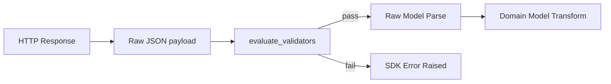
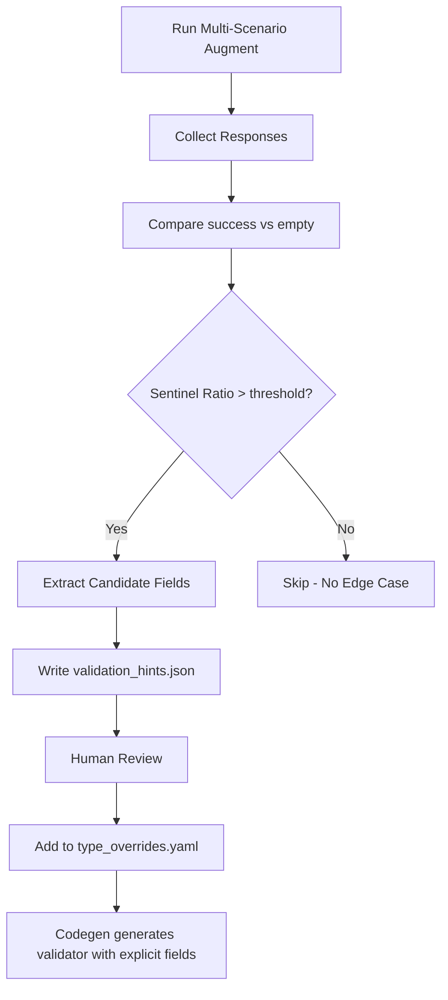
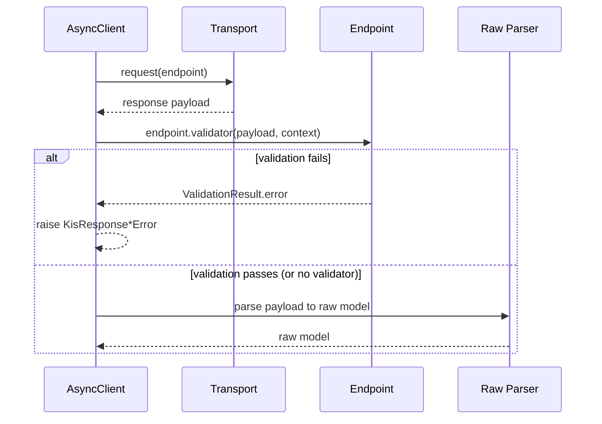
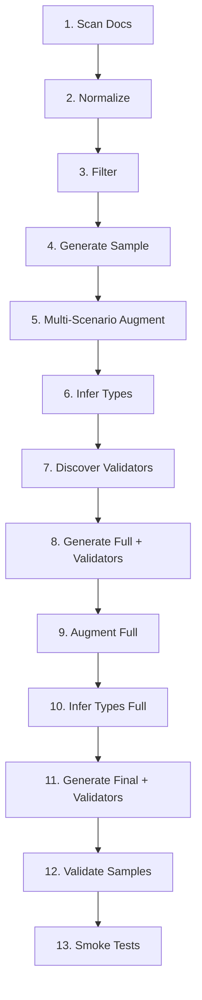

# Problem Statement

- The KIS API frequently returns HTTP 200 with `rt_cd`/`msg_cd` that do not reliably indicate invalid requests.
- Invalid requests often return structurally "valid" payloads with missing fields or sentinel values such as `""`, `"0"`, `"0.0"`, `"000000"`, `"00000000"`.
- Some responses omit fields entirely (missing keys), which must be treated as invalid for certain endpoints.
- Current mitigation (making fields nullable) hides the real issue and silently accepts invalid responses (e.g., `e27baf2f-6ec0-4029-b4fd-4c873f340478`).

## AS-IS Analysis

### Current Error Handling

```
PykisError (base)
└── KisApiError
    ├── KisAuthError          # 인증/토큰 오류
    ├── KisRateLimitError     # Rate limit (429)
    ├── KisTransportError     # 네트워크/전송 오류
    ├── KisHttpError          # Non-OK HTTP 응답
    ├── KisResponseError      # rt_cd 체크 실패만 감지
    └── KisUnsupportedEndpointError  # 도메인 미지원 (✓ 이미 구현됨)
```

> **도메인 검증 (기존 구현)**:
>
> ```python
> # client.py lines 528-535
> tr_id = endpoint.real_tr_id if self.domain == "real" else endpoint.demo_tr_id
> if tr_id is None:
>     raise KisUnsupportedEndpointError(
>         f"endpoint not supported in {self.domain} domain: {endpoint.id}",
>         ...
>     )
> ```
>
> → Validator 시스템 범위 외 (요청 전 client 레벨에서 처리)

### Current Validation Flow

```
HTTP Response → JSON 추출 → rt_cd 체크 → Pydantic model_validate()
                              ↓
                         rt_cd != "0" 일 때만 에러
                              ↓
                    ★ Sentinel/빈값 검증 없음 ★
```

### Problem Case: `e27baf2f` (inquire_investor)

**API 문서**: 모든 투자자 필드 `required: true`

**장 중 실제 응답** (`raw.json`):

```json
{
  "rt_cd": "0",
  "msg_cd": "MCA00000",
  "output": [{
    "stck_bsop_date": "20260127",
    "prsn_ntby_qty": "",      // ← Sentinel (빈 문자열)
    "frgn_ntby_qty": "",      // ← Sentinel
    "orgn_ntby_qty": "",      // ← Sentinel
    // ... 18개 투자자 필드 모두 빈 문자열
  }]
}
```

**현재 SDK 동작**: 빈 문자열 → `None` 변환 → 사용자에게 원인 불명의 `None` 전달

---

# Goals

- Provide deterministic, per-endpoint response validation that can detect invalid responses and raise explicit SDK errors.
- Emit friendly, domain-specific messages where the root cause is known (e.g., market close windows).
- Keep codegen deterministic and offline; validators are generated at build-time from YAML.
- Replace nullable overrides with validation rules where appropriate (e.g., `e27baf2f-6ec0-4029-b4fd-4c873f340478`), while keeping legitimate sentinel-time overrides such as `c3b78a4a-de38-43fb-a78d-4018b1ea4d4f`.
- Make validation consistent across async/sync clients and streaming paths where applicable.
- **Build a multi-scenario testing system** that validates success/empty/error responses during codegen.

# Non-Goals

- Rewriting KIS upstream behavior or adding network retries.
- Changing the semantics of truly optional fields defined by KIS.
- Adding runtime schema inference from live payloads.
- **Domain 지원 여부 검증**: `demo_tr_id`/`real_tr_id`로 이미 Endpoint에 명시되며, client에서 요청 전 `KisUnsupportedEndpointError`로 처리됨 (기존 구현 유지).

# User Stories

- As an SDK user, I get a clear error when KIS returns an invalid payload instead of silent `None`/zero values.
- As an SDK maintainer, I can codify per-endpoint validation rules in YAML without editing runtime code.
- As a QA engineer, I can reproduce invalid response errors deterministically via fixtures.

---

# Requirements

## Functional

- YAML-based validators scoped by endpoint UUID.
- Support for rules that detect:
  - Missing required fields (including missing output blocks).
  - Missing keys within rows (field absent vs empty value).
  - Sentinel values (empty string, zero, zero-time/date) for fields that must be meaningful.
  - "All-zero rows" or "all-empty rows" in output arrays.
  - Invalid combinations (e.g., fields A+B empty together means invalid).

> **Note**: Demo/real 도메인 지원 여부 검증은 **Validator 시스템 범위 외**입니다.
>
> - `Endpoint.demo_tr_id` / `Endpoint.real_tr_id` 필드로 지원 여부가 명시됨
> - Client에서 요청 전 `KisUnsupportedEndpointError` 발생 (기존 구현)
> - 참조: `src/pykis/api/_async/client.py` lines 528-535
>
- Each rule defines:
  - `error_code`, `message`, and `exception` type to raise.
  - Optional `user_message` or `hint` for friendly, actionable messaging.
  - Optional `severity` (error|warn) and `mode` override.
  - Optional `when` clause to apply only in certain conditions (e.g., specific `rt_cd`).
- Runtime validation should run before raw model parsing for strict correctness.

## Non-Functional

- Deterministic generation from YAML; no runtime I/O.
- Minimal public API surface; validation is opt-in/out via client configuration.
- Strict typing and no `Any` in generated validator interfaces.

---

# Architecture: Endpoint-Integrated Validators

## 설계 원칙

별도의 validator 파일/레지스트리를 생성하지 않고, **Endpoint 정의에 validator를 직접 통합**합니다.

| 기존 접근 (폐기) | 새 접근 (채택) |
|-----------------|---------------|
| `response_validators.yaml` 별도 파일 | `type_overrides.yaml`에 validator 섹션 추가 |
| `validators/_registry.py` 생성 | Endpoint dataclass에 `validator` 필드 추가 |
| `validators/{endpoint_id}.py` 모듈 생성 | 각 endpoint 모듈 내에서 validator 정의 |

## Endpoint 구조 확장

```python
# src/pykis/api/raw/types.py
from pykis.api.validation.rules import ValidatorRule

@dataclass(frozen=True, slots=True)
class Endpoint(Generic[RequestT, ResponseT]):
    id: str
    name: str
    method: str
    path: str
    request_model: type[RequestT]
    response_model: type[ResponseT]
    description: str | None = None
    real_tr_id: str | None = None
    demo_tr_id: str | None = None
    auth_required: bool = True
    hashkey_required: bool = False
    validators: tuple[ValidatorRule, ...] = ()  # ★ 객체 기반 validators ★
```

## Validator Rule 클래스 정의

```python
# src/pykis/api/validation/rules.py
from dataclasses import dataclass
from typing import Literal


@dataclass(frozen=True, slots=True)
class ErrorConfig:
    """에러 설정"""
    code: str
    message: str
    user_message: str
    hint: str | None = None
    exception: type[Exception] = KisResponseUnavailableError


@dataclass(frozen=True, slots=True)
class AllFieldsSentinel:
    """모든 필드가 sentinel이면 invalid"""
    output: str
    fields: tuple[str, ...]
    sentinel_values: tuple[str, ...]
    scope: Literal["first_row", "all_rows"] = "first_row"
    error: ErrorConfig


@dataclass(frozen=True, slots=True)
class AnyFieldSentinel:
    """하나라도 sentinel이면 invalid"""
    output: str
    fields: tuple[str, ...]
    sentinel_values: tuple[str, ...]
    scope: Literal["first_row", "all_rows"] = "first_row"
    error: ErrorConfig


@dataclass(frozen=True, slots=True)
class OutputRequired:
    """output이 비어있으면 invalid"""
    output: str
    error: ErrorConfig


@dataclass(frozen=True, slots=True)
class AllFieldsMissing:
    """모든 필드 키가 없으면 invalid"""
    output: str
    fields: tuple[str, ...]
    scope: Literal["first_row", "all_rows"] = "first_row"
    error: ErrorConfig


@dataclass(frozen=True, slots=True)
class AnyFieldMissing:
    """하나라도 키가 없으면 invalid"""
    output: str
    fields: tuple[str, ...]
    scope: Literal["first_row", "all_rows"] = "first_row"
    error: ErrorConfig


# Union type for all rules
ValidatorRule = (
    AllFieldsSentinel
    | AnyFieldSentinel
    | OutputRequired
    | AllFieldsMissing
    | AnyFieldMissing
)
```

## 핵심 설계: 휴리스틱 vs 명시적 규칙 분리

```
┌─────────────────────────────────────────────────────────────────────┐
│  Codegen Discovery (휴리스틱)                                        │
│  ─────────────────────────────                                      │
│  • thresholds, min_ratio 등으로 후보 필드 자동 탐지                    │
│  • validation_hints.json에 후보 기록                                 │
│  • 수동 검토 후 type_overrides.yaml에 명시적 필드 등록                 │
└─────────────────────────────────────────────────────────────────────┘
                              ↓
┌─────────────────────────────────────────────────────────────────────┐
│  Validator YAML (명시적 필드 목록)                                    │
│  ─────────────────────────────────                                  │
│  • 정확히 어떤 필드를 검사할지 명시                                    │
│  • thresholds 없음 - 나열된 필드 전체가 조건 충족 시 invalid           │
│  • 사람이 검토하고 승인한 필드만 포함                                  │
└─────────────────────────────────────────────────────────────────────┘
                              ↓
┌─────────────────────────────────────────────────────────────────────┐
│  Generated Validator Code (결정적 검증)                              │
│  ─────────────────────────────────────                              │
│  • YAML에 명시된 필드만 정확히 검사                                   │
│  • 휴리스틱 없음 - 100% 결정적                                       │
│  • 오판 가능성 제거, 완전한 제어                                      │
└─────────────────────────────────────────────────────────────────────┘
```

## YAML Schema (type_overrides.yaml 확장)

`type_overrides.yaml`에 `validator` 섹션을 추가합니다.
**주의**: Runtime validator에는 thresholds가 없습니다. 명시된 필드 전체가 조건을 충족하면 invalid입니다.

```yaml
# docs/overrides/type_overrides.yaml
overrides:
  - id: e27baf2f-6ec0-4029-b4fd-4c873f340478
    approved_by: user
    approved_at: '2026-01-27'
    reason: "Investor data unavailable during market hours"
    evidence: "tmp/docs/augment/e27baf2f.../validation_hints.json"
    changes:
      # ★ Validator 섹션 - 명시적 필드 목록 ★
      validator:
        rules:
          - id: investor_sentinel_check
            type: all_fields_sentinel
            output: output
            scope: first_row
            # ★ 정확히 이 필드들이 모두 sentinel이면 invalid ★
            fields:
              - prsn_ntby_qty
              - frgn_ntby_qty
              - orgn_ntby_qty
              - prsn_ntby_tr_pbmn
              - frgn_ntby_tr_pbmn
              - orgn_ntby_tr_pbmn
              - prsn_shnu_vol
              - frgn_shnu_vol
              - orgn_shnu_vol
              - prsn_seln_vol
              - frgn_seln_vol
              - orgn_seln_vol
            sentinel_values: ["", "0", "0.0"]
            error:
              code: KIS_RESPONSE_UNAVAILABLE
              message: "Investor data unavailable"
              user_message: "해당 투자자 정보는 장 종료 후 조회 가능합니다."
              hint: "당일 데이터는 장 마감 후 제공됩니다."
              exception: KisResponseUnavailableError
```

## Rule Types (Runtime - 명시적)

Runtime validator에서 사용하는 rule type들입니다. **thresholds 없이** 명시된 조건만 검사합니다.

| Type | 설명 | 트리거 조건 |
|------|------|-------------|
| `output_required` | output 배열 존재 여부 | output이 없거나 빈 배열이면 invalid |
| `all_fields_sentinel` | 모든 필드가 sentinel | 명시된 **모든** 필드가 sentinel이면 invalid |
| `any_field_sentinel` | 하나라도 sentinel | 명시된 필드 중 **하나라도** sentinel이면 invalid |
| `all_fields_missing` | 모든 필드 누락 | 명시된 **모든** 필드의 키가 없으면 invalid |
| `any_field_missing` | 하나라도 누락 | 명시된 필드 중 **하나라도** 키가 없으면 invalid |

### Rule Schema

```yaml
- id: string                    # 규칙 식별자
  type: string                  # rule type
  output: string                # output key (e.g., "output", "output1")
  scope: first_row | all_rows   # 검사 범위
  fields: [string, ...]         # ★ 명시적 필드 목록 (필수) ★
  sentinel_values: [string, ...]  # sentinel로 간주할 값들
  error:
    code: string
    message: string
    user_message: string        # 사용자 친화적 메시지
    hint: string                # 해결 방법 힌트
    exception: string           # 예외 클래스명
```

> **핵심**: `thresholds`, `min_ratio`, `min_groups` 등은 **Runtime validator에서 사용하지 않습니다**.
> 이들은 Codegen discovery 단계에서만 후보 필드 탐지에 사용됩니다.

## Scope 옵션

| Scope | 설명 |
|-------|------|
| `first_row` | 첫 번째 row만 검사 (실시간 데이터용) |
| `all_rows` | 모든 row가 조건 충족 시 invalid |
| `any_row` | 하나라도 조건 충족 시 invalid |

---

## Generated Endpoint Example

validator가 포함된 endpoint 모듈 생성 예시 (객체 기반):

```python
# src/pykis/api/raw/국내주식/기본시세/inquire_investor.py (Generated)

from pykis.api.raw.types import Endpoint
from pykis.api.validation.rules import (
    AllFieldsSentinel,
    ErrorConfig,
)
from pykis.api.errors import KisResponseUnavailableError


_ENDPOINT: Endpoint[InquireInvestorRequest, InquireInvestorResponse] = Endpoint(
    id="e27baf2f-6ec0-4029-b4fd-4c873f340478",
    name="주식현재가 투자자[v1_국내주식-012]",
    method="GET",
    path="/uapi/domestic-stock/v1/quotations/inquire-investor",
    request_model=InquireInvestorRequest,
    response_model=InquireInvestorResponse,
    description="...",
    real_tr_id="FHKST01010900",
    demo_tr_id="FHKST01010900",
    auth_required=True,
    hashkey_required=False,
    
    # ★ 객체 기반 validators - 선언적 정의 ★
    validators=(
        AllFieldsSentinel(
            output="output",
            fields=(
                "prsn_ntby_qty",
                "frgn_ntby_qty",
                "orgn_ntby_qty",
                "prsn_ntby_tr_pbmn",
                "frgn_ntby_tr_pbmn",
                "orgn_ntby_tr_pbmn",
                "prsn_shnu_vol",
                "frgn_shnu_vol",
                "orgn_shnu_vol",
                "prsn_seln_vol",
                "frgn_seln_vol",
                "orgn_seln_vol",
            ),
            sentinel_values=("", "0", "0.0"),
            scope="first_row",
            error=ErrorConfig(
                code="KIS_RESPONSE_UNAVAILABLE",
                message="Investor data unavailable",
                user_message="해당 투자자 정보는 장 종료 후 조회 가능합니다.",
                hint="당일 데이터는 장 마감 후 제공됩니다.",
                exception=KisResponseUnavailableError,
            ),
        ),
    ),
)
```

### 생성된 코드의 특징

| 특징 | 설명 |
|------|------|
| **선언적 정의** | 규칙이 데이터 객체로 명확히 표현됨 |
| **함수 생성 없음** | validator 함수 템플릿 불필요 - 객체만 생성 |
| **조합 가능** | `validators=(..., ...)` 여러 규칙 조합 |
| **직렬화 가능** | dataclass → dict 변환 용이 |
| **디버깅 용이** | `endpoint.validators`로 규칙 직접 확인 |

---

# Architecture & Flow



## Runtime Evaluator

```python
# src/pykis/api/validation/evaluator.py

from pykis.api.validation.rules import (
    ValidatorRule,
    AllFieldsSentinel,
    AnyFieldSentinel,
    OutputRequired,
    AllFieldsMissing,
    AnyFieldMissing,
)


def evaluate_rule(
    rule: ValidatorRule,
    payload: dict[str, object],
    context: ValidationContext,
) -> ValidationResult:
    """규칙 객체를 해석하여 검증 실행"""
    
    match rule:
        case AllFieldsSentinel():
            return _eval_all_fields_sentinel(rule, payload, context)
        case AnyFieldSentinel():
            return _eval_any_field_sentinel(rule, payload, context)
        case OutputRequired():
            return _eval_output_required(rule, payload, context)
        case AllFieldsMissing():
            return _eval_all_fields_missing(rule, payload, context)
        case AnyFieldMissing():
            return _eval_any_field_missing(rule, payload, context)
        case _:
            raise ValueError(f"Unknown rule type: {type(rule)}")


def evaluate_validators(
    validators: tuple[ValidatorRule, ...],
    payload: dict[str, object],
    context: ValidationContext,
) -> ValidationResult:
    """모든 validator 규칙 순차 실행"""
    
    for rule in validators:
        result = evaluate_rule(rule, payload, context)
        if not result.is_valid:
            return result
    
    return ValidationResult.ok()
```

## Client Integration

```python
# src/pykis/api/_async/client.py
from pykis.api.validation.evaluator import evaluate_validators

async def call(self, endpoint: Endpoint, request: RequestT, ...) -> ResponseT:
    ...
    data_map = extract_json(response)
    
    # ★ 객체 기반 validators 실행 ★
    if endpoint.validators and self._response_validation != "ignore":
        context = ValidationContext(
            endpoint_id=endpoint.id,
            domain=self.domain,
            method=endpoint.method,
            path=endpoint.path,
        )
        result = evaluate_validators(endpoint.validators, data_map, context)
        
        if not result.is_valid:
            if self._response_validation == "raise":
                raise result.error
            else:  # warn
                logger.warning(f"Validation failed: {result.error}")
    
    # Existing rt_cd check
    ...
```

---

# Detailed Architecture

## Components

- **Validator rules (YAML)**: `type_overrides.yaml`의 `validator` 섹션에 정의
- **Codegen loader**: type_overrides 파싱 시 validator 규칙도 함께 로드
- **Validator code generator**: endpoint 모듈 내에 validator 함수 생성
- **Validation utilities**: 재사용 가능한 rule evaluator 함수들
- **Multi-scenario augmenter**: success/empty/error 응답 수집
- **Validator discovery**: augment 데이터에서 validator 규칙 자동 탐지
- **Runtime hook**: client에서 `endpoint.validator` 호출
- **Error model**: 구조화된 에러 + context

## Folder Structure (Updated)

```
docs/overrides/
├── type_overrides.yaml       # validator 섹션 추가 (기존 파일 확장)
└── doc_overrides.yaml        # 기존 유지

src/codegen/api/
├── steps/
│   ├── generate.py           # endpoint 모듈 생성 시 validator 함수 포함
│   ├── augment.py            # multi-scenario augmentation
│   └── validate.py           # validator discovery
└── models.py                 # ValidatorRule 모델 추가

src/pykis/api/raw/
├── types.py                  # Endpoint.validator 필드 추가
├── validation/               # ★ 공통 validation 유틸리티 (신규) ★
│   ├── __init__.py
│   ├── types.py              # ValidationContext, ValidationResult
│   ├── evaluators.py         # multi_field_sentinel, output_required 등
│   ├── evaluator.py         # ★ 규칙 객체 해석/실행 (신규) ★
│   └── errors.py             # KisResponseUnavailableError 등
├── 국내주식/
│   └── 기본시세/
│       └── inquire_investor.py  # endpoint + validators 객체 정의

src/pykis/api/_async/
└── client.py                 # evaluate_validators 호출 hook

tests/
├── unit/validation/          # evaluator 단위 테스트
└── integration/validation/   # fixture 기반 통합 테스트
```

## 핵심 차이점

| 항목 | 함수형 (폐기) | 객체형 (채택) |
|------|-------------|--------------|
| Validator 정의 | `def _validate_xxx(...)` 함수 생성 | `AllFieldsSentinel(...)` 객체 생성 |
| Endpoint 필드 | `validator: ValidatorFn` 함수 참조 | `validators: tuple[ValidatorRule, ...]` 객체 튜플 |
| codegen 복잡도 | 함수 템플릿 렌더링 필요 | 객체 생성 코드만 생성 |
| 런타임 실행 | 함수 직접 호출 | `evaluate_validators()`가 객체 해석 |
| 디버깅 | 함수 내부 확인 필요 | 객체 속성 직접 확인 |
| 확장성 | 새 함수 템플릿 필요 | Rule 클래스만 추가 |

---

# Multi-Scenario Augmentation System

## 개요

Codegen 파이프라인에서 **정상/빈/비정상 요청**을 모두 테스트하여 엣지 케이스를 자동으로 발견하고 등록하는 시스템입니다.

## Augmentation 시나리오 정의

```yaml
# src/codegen/config/augment_scenarios.yaml
scenarios:
  # 1. 정상 요청 (기존)
  - id: success
    description: "Valid request with expected parameters"
    request_template: default
    expected: valid_response
    store_as: success.json

  # 2. 빈 요청 / 경계 조건
  - id: empty_params
    description: "Request with empty/minimal parameters"
    request_template: minimal
    expected: empty_or_sentinel
    store_as: empty.json

  # 3. 시간 기반 경계
  - id: market_closed
    description: "Request during market closed hours"
    conditions:
      time_window: [15:30, 09:00]  # 장 마감 후
    expected: sentinel_response
    store_as: market_closed.json

  # 4. 잘못된 파라미터
  - id: invalid_params
    description: "Request with invalid stock code or date"
    request_template: invalid
    expected: error_response
    store_as: error.json

# Note: 도메인 지원 여부는 endpoint.demo_tr_id/real_tr_id로 판단하며,
# client에서 요청 전 KisUnsupportedEndpointError가 발생합니다.
# 따라서 domain_mismatch 시나리오는 augment 대상이 아닙니다.
```

## Request Template 정의

```yaml
# per-endpoint request templates
request_templates:
  e27baf2f-6ec0-4029-b4fd-4c873f340478:
    default:
      FID_COND_MRKT_DIV_CODE: "J"
      FID_INPUT_ISCD: "005930"  # 삼성전자
    minimal:
      FID_COND_MRKT_DIV_CODE: "J"
      FID_INPUT_ISCD: "005930"
    invalid:
      FID_COND_MRKT_DIV_CODE: "J"
      FID_INPUT_ISCD: "000000"  # 존재하지 않는 종목
```

## Augment 출력 구조

```
tmp/docs/augment/{endpoint_id}/
├── success.json          # 정상 응답 (정상 파라미터)
├── empty.json            # 빈/sentinel 응답 (장 중, 경계 조건)
├── error.json            # API 에러 응답 (잘못된 파라미터)
├── market_closed.json    # 장 마감 시간대 응답 (optional)
├── edge_cases.json       # 발견된 엣지 케이스 모음
├── validation_hints.json # 자동 탐지된 validator 규칙 힌트
├── meta.json             # 메타데이터 (시나리오별 실행 정보)
└── request_*.json        # 각 시나리오별 요청 기록

# Note: domain 지원 여부는 Endpoint 정의에 명시되어 있으므로
# domain_error.json은 생성하지 않습니다.
```

## Validation Hints 자동 생성 (휴리스틱 기반)

> **주의**: `validation_hints.json`은 **후보 필드 탐지** 결과입니다.
> 사람이 검토 후 type_overrides.yaml에 **명시적 필드 목록**으로 등록해야 합니다.

`validation_hints.json` 예시:

```json
{
  "endpoint_id": "e27baf2f-6ec0-4029-b4fd-4c873f340478",
  "generated_at": "2026-01-27T10:30:00Z",
  "status": "pending_review",
  
  "discovery": {
    "heuristics_used": {
      "min_sentinel_ratio": 0.5,
      "min_fields_differ": 3
    },
    "results": {
      "sentinel_ratio": 0.857,
      "fields_with_sentinel": 12,
      "total_fields": 14
    }
  },
  
  "candidate_fields": [
    "prsn_ntby_qty",
    "frgn_ntby_qty",
    "orgn_ntby_qty",
    "prsn_ntby_tr_pbmn",
    "frgn_ntby_tr_pbmn",
    "orgn_ntby_tr_pbmn",
    "prsn_shnu_vol",
    "frgn_shnu_vol",
    "orgn_shnu_vol",
    "prsn_seln_vol",
    "frgn_seln_vol",
    "orgn_seln_vol"
  ],
  
  "evidence": {
    "success_sample": {
      "prsn_ntby_qty": "1691743",
      "frgn_ntby_qty": "703937"
    },
    "empty_sample": {
      "prsn_ntby_qty": "",
      "frgn_ntby_qty": ""
    }
  },
  
  "suggested_yaml": "# 검토 후 type_overrides.yaml에 추가\nvalidator:\n  rules:\n    - id: investor_sentinel_check\n      type: all_fields_sentinel\n      fields: [prsn_ntby_qty, frgn_ntby_qty, ...]\n      ..."
}
```

---

# Edge Case Discovery Algorithm (Codegen Only)

> **핵심**: 이 알고리즘은 **Codegen 단계에서만** 실행됩니다.
> thresholds와 휴리스틱은 **후보 필드 탐지**에만 사용되며,
> 실제 Runtime validator에는 **명시적 필드 목록**만 사용됩니다.

## 단계별 처리



## Discovery Heuristics (Codegen Only)

```python
# ★ 이 휴리스틱은 Codegen에서만 사용 - Runtime에서는 사용 안 함 ★
DISCOVERY_THRESHOLDS = {
    "min_sentinel_ratio": 0.5,    # 50% 이상 필드가 sentinel일 때 후보로 간주
    "min_fields_differ": 3,       # 최소 3개 필드가 다를 때 후보로 간주
    "confidence_threshold": 0.8,  # 자동 제안을 위한 최소 신뢰도
}

def discover_validator_candidates(
    success: dict,
    empty: dict,
    thresholds: dict = DISCOVERY_THRESHOLDS,
) -> DiscoveryResult:
    """
    휴리스틱 기반 validator 후보 필드 탐지.
    
    Returns:
        DiscoveryResult with candidate_fields for human review
    """
    diffs = compare_responses(success, empty)
    
    # 휴리스틱 적용
    if diffs.sentinel_ratio < thresholds["min_sentinel_ratio"]:
        return DiscoveryResult(status="no_candidates")
    
    if len(diffs.fields) < thresholds["min_fields_differ"]:
        return DiscoveryResult(status="too_few_fields")
    
    # 후보 필드 추출 (사람이 검토해야 함)
    return DiscoveryResult(
        status="pending_review",
        candidate_fields=[d.field for d in diffs.fields],
        confidence=diffs.sentinel_ratio,
        evidence=diffs,
    )
```

## Field Comparison Logic

```python
def compare_responses(success: dict, empty: dict) -> ComparisonResult:
    """Compare success and empty responses to detect sentinel patterns."""
    
    diffs = []
    for output_key in ["output", "output1", "output2"]:
        success_rows = success.get(output_key, [])
        empty_rows = empty.get(output_key, [])
        
        if not success_rows or not empty_rows:
            continue
        
        success_row = success_rows[0]
        empty_row = empty_rows[0]
        
        for field, empty_val in empty_row.items():
            success_val = success_row.get(field)
            
            if is_sentinel(empty_val) and not is_sentinel(success_val):
                diffs.append(FieldDiff(
                    field=field,
                    success_value=success_val,
                    empty_value=empty_val,
                    sentinel_type=classify_sentinel(empty_val)
                ))
    
    return ComparisonResult(diffs=diffs, sentinel_ratio=len(diffs)/len(empty_row))
```

## Sentinel Classification

```python
SENTINEL_PATTERNS = {
    "empty_string": [""],
    "zero_numeric": ["0", "0.0", "0.00"],
    "zero_date": ["00000000", "0000-00-00"],
    "zero_time": ["000000", "00:00:00", "888888"],
    "null_marker": [None, "null", "NULL"],
}

def is_sentinel(value: str | None) -> bool:
    """Check if value matches any sentinel pattern."""
    if value is None:
        return True
    return any(value in patterns for patterns in SENTINEL_PATTERNS.values())
```

## 휴리스틱 vs 명시적 규칙 비교

| 단계 | 사용하는 것 | 목적 |
|------|------------|------|
| **Codegen Discovery** | thresholds, min_ratio | 후보 필드 자동 탐지 |
| **Human Review** | validation_hints.json | 후보 필드 검토 및 승인 |
| **type_overrides.yaml** | 명시적 필드 목록 | 승인된 필드만 등록 |
| **Runtime Validator** | 명시적 필드 목록 | 정확히 명시된 필드만 검사 |

---

# Data Flow (Detailed)



> **핵심**: `endpoint.validator`를 직접 호출하므로 별도 registry lookup이 없습니다.

---

# Error Model

- Introduce/standardize a base `KisError` (subclass of `PykisError`) in [errors.py](/Users/taehoon/Desktop/soju/python-kis/src/pykis/api/errors.py), and ensure all validator errors inherit from it via `KisResponseError`.
- Extend [errors.py](/Users/taehoon/Desktop/soju/python-kis/src/pykis/api/errors.py) with specialized response errors under `KisResponseError`:
  - `KisResponseIncompleteError` (missing keys/fields)
  - `KisResponseUnavailableError` (known "not available yet" cases such as market close)
  - `KisResponseSentinelError` (sentinel values indicate invalid payload)
  - `KisInvalidResponseError` (fallback/unknown invalid payload)

> **Note**: 도메인 지원 여부 에러는 Validator 범위 외입니다.
>
> - 기존 `KisUnsupportedEndpointError`가 client에서 발생 (요청 전 검증)
> - `endpoint.demo_tr_id` / `endpoint.real_tr_id`가 `None`이면 해당 도메인 미지원
>
- Required fields on errors:
  - `endpoint_id`, `domain`, `request_id` (if present), `error_code`, `message`, `rule_id`, `rule_type`, `details`.
- Support `mode` configuration:
  - `raise` (default), `warn`, `ignore`.
- Allow a separate `user_message` for friendly UX where available.

## Error Payload Schema (runtime)

- The raised exception must carry structured payload for debugging and support:
  - `context`: `endpoint_id`, `method`, `path`, `status_code`, `domain`, `request_id`
  - `rule`: `id`, `type`, `when`, `thresholds`, `predicates`
  - `raw_capture`: selected raw fields/rows from the response payload
  - `raw_payload_excerpt`: bounded snapshot of the original payload (redacted)
  - `evaluated`: per-field evaluation results (e.g., missing, sentinel match, ratio)
- Capture behavior is controlled by the rule `capture` block:
  - `fields`: list of field names to include from the first N rows
  - `outputs`: list of outputs to include
  - `max_rows`: limit to avoid excessive payload size
  - `redact_keys`: list of keys to mask (e.g., account numbers, tokens)

---

# Codegen Integration

## Pipeline Stages (Updated)



> **핵심 변경**: "Generate Validators" 단계가 별도가 아닌 "Generate" 단계에 통합됩니다.
> endpoint 모듈 생성 시 validator 함수도 함께 생성됩니다.

### Stage 5: Multi-Scenario Augment (신규/확장)

```python
async def run_multi_scenario_augment(
    specs: list[EndpointSpec],
    scenarios: list[AugmentScenario],
    out_dir: Path,
) -> MultiScenarioReport:
    """Run multiple request scenarios per endpoint."""
    
    results = []
    for spec in specs:
        endpoint_dir = out_dir / spec.id
        
        for scenario in scenarios:
            request = build_request(spec, scenario)
            response = await call_api(spec, request)
            
            # Store response
            (endpoint_dir / f"{scenario.id}.json").write_text(
                json.dumps(response, ensure_ascii=False, indent=2)
            )
            
            results.append(ScenarioResult(
                endpoint_id=spec.id,
                scenario=scenario.id,
                status="success" if response else "failed",
            ))
    
    return MultiScenarioReport(results=results)
```

### Stage 7: Discover Validators (신규)

```python
def discover_validators(
    specs: list[EndpointSpec],
    augment_dir: Path,
) -> dict[str, ValidatorHint]:
    """Auto-detect validator rules from multi-scenario augment data."""
    
    hints = {}
    for spec in specs:
        endpoint_dir = augment_dir / spec.id
        
        success = load_json(endpoint_dir / "success.json")
        empty = load_json(endpoint_dir / "empty.json")
        
        if success and empty:
            comparison = compare_responses(success, empty)
            if comparison.sentinel_ratio > 0.3:
                hint = generate_multi_field_sentinel_hint(spec, comparison)
                hints[spec.id] = hint
        
        # Write hints for review
        (endpoint_dir / "validation_hints.json").write_text(
            json.dumps(hint.to_dict() if spec.id in hints else {}, indent=2)
        )
    
    return hints
```

### Stage 8 & 11: Generate Endpoint + Validators (객체 생성)

```python
def generate_endpoint_module(
    spec: EndpointSpec,
    type_override: TypeOverride | None,
    template: Template,
    out_path: Path,
) -> None:
    """Generate endpoint module with validator objects.
    
    ★ 핵심: validator 객체는 type_overrides.yaml에 등록된 경우만 생성 ★
    - 함수 템플릿 불필요 - 객체 생성 코드만 렌더링
    - validation_hints.json의 후보는 자동으로 사용되지 않음
    """
    
    # type_override에서만 validator 규칙 로드
    validator_rules = []
    if type_override and type_override.validator:
        validator_rules = type_override.validator.rules
    
    # 템플릿에 validator 객체 포함하여 렌더링
    content = template.render(
        spec=spec,
        type_override=type_override,
        validator_rules=validator_rules,  # 빈 리스트면 validators=() 생성
    )
    
    out_path.write_text(content)
```

### 객체 생성 템플릿 예시

```jinja2
{# endpoint.py.jinja2 #}

from pykis.api.validation.rules import (
    
    {{ rule.class_name }},
    
    ErrorConfig,
)


_ENDPOINT: Endpoint[{{ request_model }}, {{ response_model }}] = Endpoint(
    id="{{ spec.id }}",
    ...
    validators=(
        
        {{ rule.class_name }}(
            output="{{ rule.output }}",
            fields={{ rule.fields | tojson }},
            sentinel_values={{ rule.sentinel_values | tojson }},
            scope="{{ rule.scope }}",
            error=ErrorConfig(
                code="{{ rule.error.code }}",
                message="{{ rule.error.message }}",
                user_message="{{ rule.error.user_message }}",
                hint="{{ rule.error.hint }}",
                exception={{ rule.error.exception }},
            ),
        ),
        
    ),
)
```

> **핵심 원칙**:
>
> - 함수 템플릿 불필요 - 객체 생성 코드만 렌더링
> - `validation_hints.json`은 **참고용**으로만 생성
> - validator는 **오직 type_overrides.yaml에 등록된 경우만** 생성
> - 자동 생성/자동 적용 없음 → 완전한 제어권 보장

---

# Runtime Integration

- `endpoint.validators` 튜플에 규칙 객체들 포함
- `evaluate_validators()`가 객체 해석 및 검증 실행
- Client config flag: `response_validation` = `raise|warn|ignore`

## Client Hook Implementation

```python
# In KisRawClient.call()
from pykis.api.validation.evaluator import evaluate_validators

async def call(self, endpoint: Endpoint, request: RequestT, ...) -> ResponseT:
    ...
    response = await self._request(endpoint, request, ...)
    data_map = extract_json(response)
    
    # ★ 객체 기반 validators 실행 ★
    if endpoint.validators and self._response_validation != "ignore":
        context = ValidationContext(
            endpoint_id=endpoint.id,
            domain=self.domain,
            method=endpoint.method,
            path=endpoint.path,
            status_code=response.status_code,
        )
        # 규칙 객체들을 순회하며 검증
        result = evaluate_validators(endpoint.validators, data_map, context)
        
        if not result.is_valid:
            if self._response_validation == "raise":
                raise result.error
            else:  # warn
                logger.warning(f"Validation failed: {result.error}")
    
    # Existing rt_cd check
    if str(data_map.get("rt_cd")) not in ("0", "OK"):
        raise KisResponseError(...)
    
    return endpoint.response_model.model_validate(data_map), response
```

---

# Migration Plan

- Revert nullable overrides for endpoints that should be validated instead (starting with `e27baf2f...`).
- Keep true optional fields as `required: false` in type overrides (e.g., `c3b78a4a...` time sentinels).
- Add validator rules incrementally per endpoint as issues are discovered.

## Migration Priority

| Priority | Endpoints | Reason |
|----------|-----------|--------|
| P0 | `e27baf2f` (inquire_investor) | 대표적인 sentinel masking 케이스 |
| P1 | `a87c0275`, `1d150774`, `5613b629` | 888888 sentinel time |
| P1 | `9064a50c` | 10개 필드 누락 |
| P2 | `77de2a74`, `86194480` | KOSPI200 conditional fields |
| P3 | 기타 type_overrides의 `required: false` 항목들 | 점진적 전환 |

---

# Testing Strategy

## Unit Tests

- YAML schema parsing and validation
- Rule evaluator logic (per rule type) - 명시적 필드 목록 기반
- `all_fields_sentinel`, `any_field_sentinel` 등 evaluator 함수
- Discovery heuristics (Codegen용 threshold 기반 후보 탐지)

## Integration Tests

- Fixture-based validation using `tmp/docs/augment/` data
- Success/empty/error scenario comparison
- Cross-validation with Pydantic models

## Snapshot Tests

- Generated validator code stability
- Error message formatting
- Validation hints output

## End-to-End Tests

- Full pipeline run with multi-scenario augment
- Validator discovery accuracy
- Runtime validation behavior

---

# Rollout & Compatibility

- Phase 1: default `warn`, opt-in `raise` for strict mode.
- Phase 2: default `raise` after validation coverage stabilizes.
- Document migration notes in release notes and SDK docs.

## Rollout Phases

| Phase | Mode | Coverage | Duration |
|-------|------|----------|----------|
| Alpha | `warn` | e27baf2f only | 1 sprint |
| Beta | `warn` | P0 + P1 endpoints | 2 sprints |
| GA | `raise` default | All discovered | 1 sprint |

---

# Risks & Mitigations

## 1. False Positives on Legitimate Zero Values

**Risk**: 실제로 0이 유효한 값인 경우 (예: 거래량 0, 순매수 0) false positive 발생

**Mitigations**:

| 전략 | 설명 |
|------|------|
| **명시적 필드 목록** | YAML에 정확히 어떤 필드를 검사할지 명시 - 휴리스틱 없음 |
| **Human Review 필수** | validation_hints.json → 사람 검토 → type_overrides.yaml 등록 |
| **`all_fields_sentinel` 사용** | 명시된 **모든** 필드가 sentinel일 때만 invalid |
| **Sentinel 값 명시** | `sentinel_values: ["", "0"]` - 정확히 이 값들만 sentinel로 간주 |
| **Scope 제한** | `scope: first_row` - 첫 번째 row만 검사 |

**Implementation**:

```yaml
# Runtime validator - 휴리스틱 없음, 명시적 필드만 검사
validator:
  rules:
    - id: investor_sentinel_check
      type: all_fields_sentinel
      fields:  # 정확히 이 12개 필드가 모두 sentinel이면 invalid
        - prsn_ntby_qty
        - frgn_ntby_qty
        - orgn_ntby_qty
        # ... (명시적으로 나열)
      sentinel_values: ["", "0", "0.0"]
      scope: first_row
```

## 2. Discovery vs Runtime 분리

**Risk**: 휴리스틱 기반 자동 탐지가 잘못된 필드를 포함할 수 있음

**Mitigations**:

| 전략 | 설명 |
|------|------|
| **자동 적용 금지** | validation_hints.json은 참고용, 자동으로 validator 생성 안 함 |
| **Human Review 필수** | 모든 validator 규칙은 사람이 검토 후 type_overrides.yaml에 등록 |
| **Evidence 기록** | hints에 success/empty 샘플 값 포함하여 판단 근거 제공 |
| **Approval Metadata** | type_overrides.yaml에 `approved_by`, `approved_at`, `evidence` 필수 |

## 3. Multi-Scenario Augment Overhead

**Risk**: 시나리오 수 증가로 augmentation 시간/비용 증가

**Mitigations**:

| 전략 | 설명 |
|------|------|
| **Incremental Augment** | 변경된 endpoint만 재실행 |
| **Scenario Caching** | 동일 요청에 대한 응답 캐싱 |
| **Rate Limit Awareness** | KIS API rate limit 고려한 스케줄링 |
| **Optional Scenarios** | 필수(success, error) + 선택(empty, market_closed) 구분 |

## 4. Breaking Changes for Users

**Risk**: validation 도입으로 기존에 동작하던 코드가 에러 발생

**Mitigations**:

| 전략 | 설명 |
|------|------|
| **Warn-First Rollout** | Phase 1에서 `warn` 기본값으로 시작 |
| **Config Flag** | `response_validation="ignore"`로 비활성화 가능 |
| **Clear Error Messages** | `user_message`, `hint`로 해결 방법 안내 |
| **Migration Guide** | 릴리즈 노트에 마이그레이션 가이드 포함 |

## 5. Sentinel Value Evolution

**Risk**: KIS API가 새로운 sentinel 패턴을 도입할 수 있음

**Mitigations**:

| 전략 | 설명 |
|------|------|
| **Extensible Sentinel List** | YAML에서 `sentinel_values` 목록 확장 가능 |
| **Periodic Re-augment** | 정기적으로 multi-scenario augment 재실행 |
| **Anomaly Detection** | 기존 패턴과 다른 응답 감지 시 알림 |

---

# Appendix: Discovery Heuristics (Codegen Only)

> **주의**: 이 섹션의 thresholds는 **Codegen Discovery 단계에서만** 사용됩니다.
> Runtime validator에서는 사용되지 않습니다.

## 권장 Discovery 임계값

| 엔드포인트 유형 | min_sentinel_ratio | min_fields_differ |
|----------------|-------------------|-------------------|
| 투자자 정보 | 0.5 | 6 |
| 시세 정보 | 0.6 | 4 |
| 주문/체결 | 0.8 | 2 |

## Threshold 결정 기준 (Discovery용)

1. **Response의 field 수**: 필드가 많을수록 ratio 낮춤 (더 많은 후보 탐지)
2. **Sentinel 발생 빈도**: 자주 발생하면 ratio 높임 (noise 줄이기)
3. **검토 가능량**: ratio 낮추면 후보가 많아짐 → 검토 부담 증가

---

# Appendix: Validator Rule Classes (Runtime)

## Rule Classes

| Class | Description | Trigger 조건 |
|-------|-------------|-------------|
| `OutputRequired` | output 배열 존재 여부 | output 없거나 빈 배열 |
| `AllFieldsSentinel` | 모든 필드가 sentinel | **모든** 명시 필드가 sentinel |
| `AnyFieldSentinel` | 하나라도 sentinel | **하나라도** sentinel |
| `AllFieldsMissing` | 모든 필드 키 누락 | **모든** 명시 필드 키 없음 |
| `AnyFieldMissing` | 하나라도 키 누락 | **하나라도** 키 없음 |

> **핵심**: thresholds, min_ratio 등은 Runtime에서 사용하지 않습니다.
> 규칙 객체의 명시된 필드에 대해 결정적으로 검사합니다.

## Rule Class Definitions

```python
# src/pykis/api/validation/rules.py

@dataclass(frozen=True, slots=True)
class ErrorConfig:
    code: str
    message: str
    user_message: str
    hint: str | None = None
    exception: type[Exception] = KisResponseUnavailableError


@dataclass(frozen=True, slots=True)
class AllFieldsSentinel:
    output: str
    fields: tuple[str, ...]
    sentinel_values: tuple[str, ...]
    scope: Literal["first_row", "all_rows"] = "first_row"
    error: ErrorConfig


@dataclass(frozen=True, slots=True)
class AnyFieldSentinel:
    output: str
    fields: tuple[str, ...]
    sentinel_values: tuple[str, ...]
    scope: Literal["first_row", "all_rows"] = "first_row"
    error: ErrorConfig


@dataclass(frozen=True, slots=True)
class OutputRequired:
    output: str
    error: ErrorConfig


@dataclass(frozen=True, slots=True)
class AllFieldsMissing:
    output: str
    fields: tuple[str, ...]
    scope: Literal["first_row", "all_rows"] = "first_row"
    error: ErrorConfig


@dataclass(frozen=True, slots=True)
class AnyFieldMissing:
    output: str
    fields: tuple[str, ...]
    scope: Literal["first_row", "all_rows"] = "first_row"
    error: ErrorConfig


ValidatorRule = (
    AllFieldsSentinel
    | AnyFieldSentinel
    | OutputRequired
    | AllFieldsMissing
    | AnyFieldMissing
)
```

## YAML to Class Mapping

| YAML `type` | Python Class |
|-------------|--------------|
| `output_required` | `OutputRequired` |
| `all_fields_sentinel` | `AllFieldsSentinel` |
| `any_field_sentinel` | `AnyFieldSentinel` |
| `all_fields_missing` | `AllFieldsMissing` |
| `any_field_missing` | `AnyFieldMissing` |

```yaml
# type_overrides.yaml 예시
validator:
  rules:
    - type: all_fields_sentinel   # → AllFieldsSentinel 클래스
      output: output
      fields: [prsn_ntby_qty, frgn_ntby_qty]
      sentinel_values: ["", "0"]
      scope: first_row
      error:
        code: KIS_RESPONSE_UNAVAILABLE
        message: "Investor data unavailable"
        user_message: "장 마감 후 조회 가능합니다."
        hint: "당일 데이터는 15:30 이후 제공됩니다."
        exception: KisResponseUnavailableError
```

## Scope Options

| Scope | Description |
|-------|-------------|
| `first_row` | 첫 번째 row만 검사 |
| `all_rows` | 모든 row가 조건 충족 시 invalid |

> **Note**: `domain_unsupported`는 Validator 범위 외입니다.
> 도메인 지원 여부는 `Endpoint.demo_tr_id`/`real_tr_id`로 판단하며,
> client에서 요청 전 `KisUnsupportedEndpointError`가 발생합니다.
