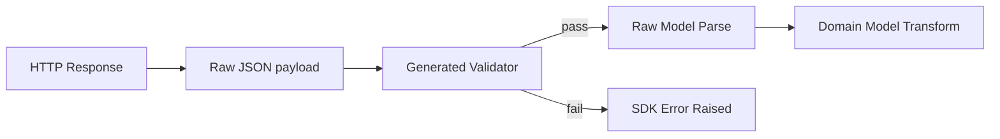

---
name: KIS Response Validators
overview: Define per-endpoint YAML response validators to detect invalid KIS payloads (missing/zero/sentinel fields) and raise deterministic, user-friendly SDK errors, replacing nullable-type overrides where invalid payloads are being masked (e.g., e27baf2f).
todos:
  - id: T1
    content: Define validator YAML schema + examples + governance rules
    status: pending
  - id: T2
    content: Add codegen parser + generator for validators
    status: pending
  - id: T3
    content: Integrate runtime validation + error types in async client
    status: pending
  - id: T4
    content: Migrate e27baf2f + additional endpoints and update tests
    status: pending
  - id: T5
    content: Rollout plan + docs + deprecation of nullable overrides
    status: pending

# Problem Statement

- The KIS API frequently returns HTTP 200 with `rt_cd`/`msg_cd` that do not reliably indicate invalid requests.
- Invalid requests often return structurally “valid” payloads with missing fields or sentinel values such as `""`, `"0"`, `"0.0"`, `"000000"`, `"00000000"`.
- Some responses omit fields entirely (missing keys), which must be treated as invalid for certain endpoints.
- Current mitigation (making fields nullable) hides the real issue and silently accepts invalid responses (e.g., `e27baf2f-6ec0-4029-b4fd-4c873f340478`).

# Goals

- Provide deterministic, per-endpoint response validation that can detect invalid responses and raise explicit SDK errors.
- Emit friendly, domain-specific messages where the root cause is known (e.g., market close windows).
- Keep codegen deterministic and offline; validators are generated at build-time from YAML.
- Replace nullable overrides with validation rules where appropriate (e.g., `e27baf2f-6ec0-4029-b4fd-4c873f340478`), while keeping legitimate sentinel-time overrides such as `c3b78a4a-de38-43fb-a78d-4018b1ea4d4f`.
- Make validation consistent across async/sync clients and streaming paths where applicable.

# Non-Goals

- Rewriting KIS upstream behavior or adding network retries.
- Changing the semantics of truly optional fields defined by KIS.
- Adding runtime schema inference from live payloads.

# User Stories

- As an SDK user, I get a clear error when KIS returns an invalid payload instead of silent `None`/zero values.
- As an SDK maintainer, I can codify per-endpoint validation rules in YAML without editing runtime code.
- As a QA engineer, I can reproduce invalid response errors deterministically via fixtures.

# Requirements

## Functional

- YAML-based validators scoped by endpoint UUID.
- Support for rules that detect:
  - Missing required fields (including missing output blocks).
  - Missing keys within rows (field absent vs empty value).
  - Sentinel values (empty string, zero, zero-time/date) for fields that must be meaningful.
  - “All-zero rows” or “all-empty rows” in output arrays.
  - Demo/real domain unsupported (endpoint not available in current domain).
  - Invalid combinations (e.g., fields A+B empty together means invalid).
- Each rule defines:
  - `error_code`, `message`, and `exception` type to raise.
  - Optional `user_message` or `hint` for friendly, actionable messaging.
  - Optional `severity` (error|warn) and `mode` override.
  - Optional `when` clause to apply only in certain conditions (e.g., specific `rt_cd`).
- Runtime validation should run before raw model parsing for strict correctness.

## Non-Functional

- Deterministic generation from YAML; no runtime I/O.
- Minimal public API surface; validation is opt-in/out via client configuration.
- Strict typing and no `Any` in generated validator interfaces.

# Proposed YAML Schema

- New file: [response_validators.yaml](/Users/taehoon/Desktop/soju/python-kis/docs/overrides/response_validators.yaml)
- Schema (draft):
  - `version`, `notes`, `validators` (list).
  - Validator entry:
    - `id`: endpoint UUID
    - `name`: short label
    - `rules`: list of rules
    - `when` (optional): conditions on headers/body
  - Rule entry:
    - `id`
    - `type`: one of `output_required`, `row_required_fields`, `row_all_of`, `row_any_of`, `field_sentinel`, `field_missing`, `domain_unsupported`
    - `output`: output key (e.g., `output`, `output1`)
    - `fields` / `predicates`
    - `error`: `{code, message, exception, user_message, hint}`
    - `capture` (optional): `{fields, outputs, max_rows, redact_keys}`
    - `severity`: `error` or `warn`
    - `thresholds` (optional): `min_rows`, `min_ratio`

## Example: e27baf2f

```yaml
validators:
  - id: e27baf2f-6ec0-4029-b4fd-4c873f340478
    name: inquire_investor
    rules:
      - id: output_required
        type: output_required
        output: output
        error:
          code: KIS_RESPONSE_INCOMPLETE
          message: "Empty output; request may be invalid."
          user_message: "해당 투자자 정보는 장 종료 후 조회 가능합니다."
          exception: KisResponseUnavailableError
      - id: numeric_fields_present
        type: row_required_fields
        output: output
        fields:
          - prsn_ntby_qty
          - frgn_ntby_qty
          - orgn_ntby_qty
          - prsn_ntby_tr_pbmn
          - frgn_ntby_tr_pbmn
          - orgn_ntby_tr_pbmn
        error:
          code: KIS_RESPONSE_INCOMPLETE
          message: "Investor summary fields missing; response may be invalid for the request context."
          user_message: "해당 투자자 정보는 장 종료 후 조회 가능합니다."
          exception: KisResponseIncompleteError
      - id: numeric_fields_missing_keys
        type: field_missing
        output: output
        fields:
          - prsn_ntby_qty
          - frgn_ntby_qty
          - orgn_ntby_qty
        thresholds:
          min_ratio: 0.1
        error:
          code: KIS_RESPONSE_INCOMPLETE
          message: "Investor fields missing from payload."
          user_message: "응답 필드가 누락되었습니다. 장 종료 이후 다시 조회해 주세요."
          exception: KisResponseIncompleteError
      - id: empty_string_sentinels
        type: field_sentinel
        output: output
        fields:
          - prsn_ntby_qty
          - frgn_ntby_qty
          - orgn_ntby_qty
          - prsn_ntby_tr_pbmn
          - frgn_ntby_tr_pbmn
          - orgn_ntby_tr_pbmn
          - prsn_shnu_vol
          - frgn_shnu_vol
          - orgn_shnu_vol
          - prsn_seln_vol
          - frgn_seln_vol
          - orgn_seln_vol
        sentinel_values:
          - ""
          - "0"
          - "0.0"
        thresholds:
          min_ratio: 0.5
        error:
          code: KIS_RESPONSE_UNAVAILABLE
          message: "Investor fields contain sentinel blanks/zeros; request may be invalid."
          user_message: "해당 투자자 정보는 장 종료 후 조회 가능합니다."
          exception: KisResponseUnavailableError
```

## Example: demo/real unsupported

```yaml
validators:
  - id: 00000000-0000-0000-0000-000000000000
    name: some_endpoint
    rules:
      - id: demo_unsupported
        type: domain_unsupported
        when:
          domain: demo
        error:
          code: KIS_DEMO_UNSUPPORTED
          message: "This endpoint is not supported in demo."
          user_message: "데모 환경에서는 지원되지 않는 API입니다."
          exception: KisDemoUnsupportedError
      - id: real_unsupported
        type: domain_unsupported
        when:
          domain: real
        error:
          code: KIS_REAL_UNSUPPORTED
          message: "This endpoint is not supported in real."
          user_message: "실전 환경에서는 지원되지 않는 API입니다."
          exception: KisRealUnsupportedError
```

# Architecture & Flow



# Error Model

- Introduce/standardize a base `KisError` (subclass of `PykisError`) in [errors.py](/Users/taehoon/Desktop/soju/python-kis/src/pykis/api/errors.py), and ensure all validator errors inherit from it via `KisResponseError`.
- Extend [errors.py](/Users/taehoon/Desktop/soju/python-kis/src/pykis/api/errors.py) with specialized response errors under `KisResponseError`:
  - `KisResponseIncompleteError` (missing keys/fields)
  - `KisResponseUnavailableError` (known “not available yet” cases such as market close)
  - `KisResponseSentinelError` (sentinel values indicate invalid payload)
  - `KisInvalidResponseError` (fallback/unknown invalid payload)
- Add domain-specific endpoint errors (could extend `KisUnsupportedEndpointError`):
  - `KisDemoUnsupportedError` (demo unsupported)
  - `KisRealUnsupportedError` (real unsupported)
- Required fields on errors:
  - `endpoint_id`, `domain`, `request_id` (if present), `error_code`, `message`, `rule_id`, `rule_type`, `details`.
- Support `mode` configuration:
  - `raise` (default), `warn`, `ignore`.
- Allow a separate `user_message` for friendly UX where available.

## Error Payload Schema (runtime)

- The raised exception must carry structured payload for debugging and support:
  - `context`: `endpoint_id`, `method`, `path`, `status_code`, `domain`, `request_id`
  - `rule`: `id`, `type`, `when`, `thresholds`, `predicates`
  - `raw_capture`: selected raw fields/rows from the response payload
  - `raw_payload_excerpt`: bounded snapshot of the original payload (redacted)
  - `evaluated`: per-field evaluation results (e.g., missing, sentinel match, ratio)
- Capture behavior is controlled by the rule `capture` block:
  - `fields`: list of field names to include from the first N rows
  - `outputs`: list of outputs to include
  - `max_rows`: limit to avoid excessive payload size
  - `redact_keys`: list of keys to mask (e.g., account numbers, tokens)

# Codegen Integration

- Add parser for validator YAML in codegen pipeline (new step).
- Generate validator registry module:
  - Example target: [validators/_registry.py](/Users/taehoon/Desktop/soju/python-kis/src/pykis/api/raw/validators/_registry.py)
  - Map `endpoint_id -> validate(payload, context)`
- Keep validators pure functions with typed inputs.

# Runtime Integration

- Hook into raw response handling before model parsing.
- Suggested entry point: request execution in async client (e.g., [client.py](/Users/taehoon/Desktop/soju/python-kis/src/pykis/api/_async/client.py)).
- Provide client config flag: `response_validation` = `raise|warn|ignore`.

# Migration Plan

- Revert nullable overrides for endpoints that should be validated instead (starting with `e27baf2f...`).
- Keep true optional fields as `required: false` in type overrides (e.g., `c3b78a4a...` time sentinels).
- Add validator rules incrementally per endpoint as issues are discovered.

# Testing Strategy

- Unit tests for rule evaluators and YAML parsing.
- Snapshot tests for generated validator code.
- Integration tests using fixtures from [tmp/docs/augment](/Users/taehoon/Desktop/soju/python-kis/tmp/docs/augment) to confirm error raising.

# Rollout & Compatibility

- Phase 1: default `warn`, opt-in `raise` for strict mode.
- Phase 2: default `raise` after validation coverage stabilizes.
- Document migration notes in release notes and SDK docs.

# Risks & Mitigations

- False positives on legitimate zero values.
  - Mitigation: rule thresholds, scoped fields, and sampling before enforcement.
- Increased breaking changes for users.
  - Mitigation: staged rollout + configuration flag.

# Open Questions

- Should validators also apply to streaming payloads, or only REST responses?
- Do we need rule inheritance for endpoint families to reduce duplication?
- What is the minimum viable set of rules to flip default to `raise`?
- How do we localize `user_message` values (Korean/English) without bloating YAML?
