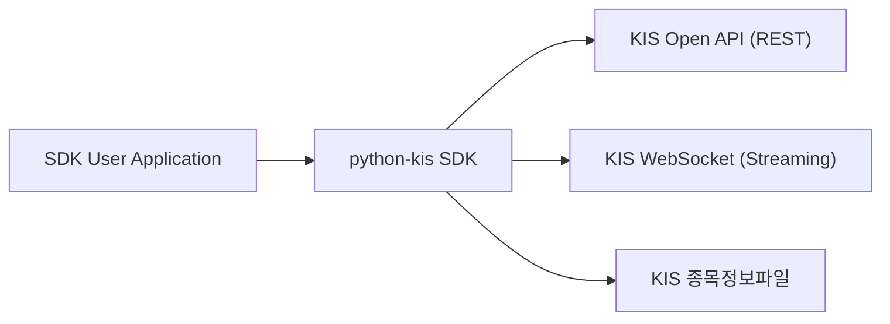
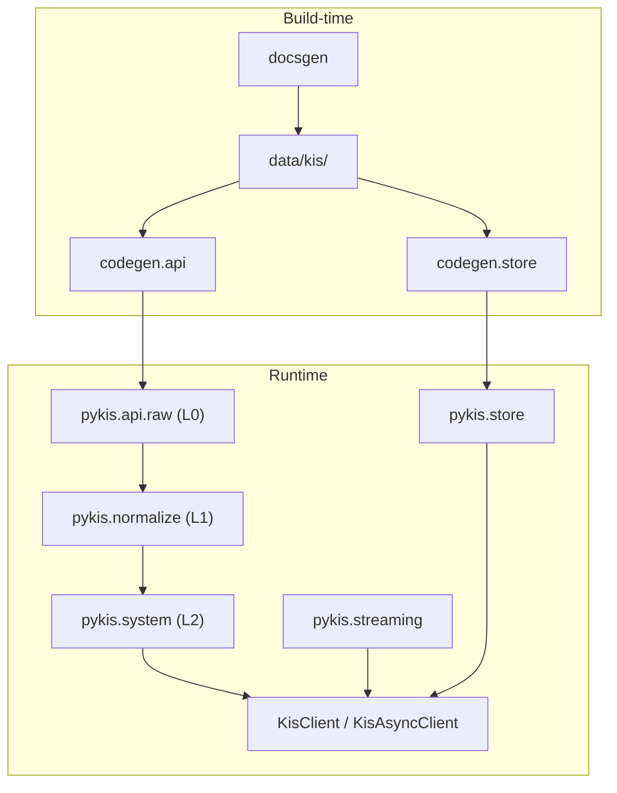

# Software Architecture Description — Index

IEEE 42010 / C4 경량 적용.

## C4 Context

## C4 Container

## Documents

| Document | Description |
|----------|-------------|
| [layered-model.md](layered-model.md) | L0/L1/L2 레이어 아키텍처 |
| [codegen-pipeline.md](codegen-pipeline.md) | 코드젠 파이프라인 아키텍처 |
| [streaming.md](streaming.md) | 실시간 스트리밍 아키텍처 |
| [public-api-design.md](public-api-design.md) | Public API 설계 (v3 Surface) |
| [adr/](adr/) | Architecture Decision Records |

## ADR Index

| ADR | Title | Status |
|-----|-------|--------|
| [ADR-001](adr/ADR-001-async-first.md) | Async-First with unasync Generation | Accepted |
| [ADR-002](adr/ADR-002-pydantic-public.md) | Pydantic for Public API Models | Accepted |
| [ADR-003](adr/ADR-003-httpx-transport.md) | httpx as HTTP Transport | Accepted |
| [ADR-004](adr/ADR-004-streaming-appkey-sessions.md) | Appkey-Shared WebSocket Sessions | Accepted |
| [ADR-005](adr/ADR-005-codegen-deterministic.md) | Deterministic Code Generation | Accepted |
| [ADR-006](adr/ADR-006-override-hitl.md) | HITL Override Approval | Accepted |
| [ADR-007](adr/ADR-007-layer-separation.md) | Layer 0/1/2 Separation | Accepted |
| [ADR-008](adr/ADR-008-response-validators.md) | Endpoint-Integrated Response Validators | Accepted |
| [ADR-009](adr/ADR-009-normalization-pipeline.md) | Normalization Pipeline (Codeagent) | Accepted |
| [ADR-010](adr/ADR-010-store-canonical-path.md) | Store Ingestion Canonical Path | Accepted |
| [ADR-011](adr/ADR-011-error-model.md) | SDK Error Model Contracts | Accepted |
