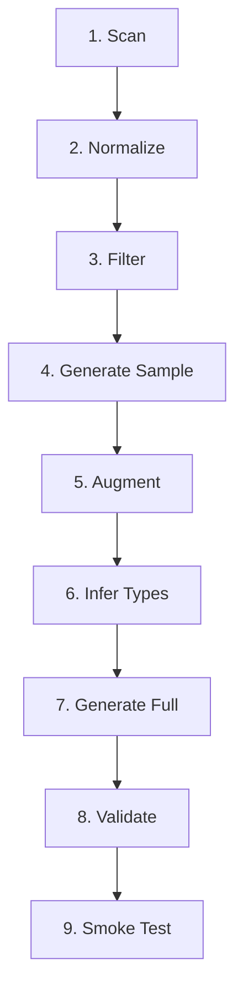

# Codegen Pipeline Architecture

## Overview

코드젠 파이프라인은 빌드타임에 KIS API 문서를 읽어 Pydantic 모델과 endpoint 정의를 자동 생성한다.

## Pipeline Stages



### 1. Scan

`data/kis/**/*.yaml` 문서를 스캔하여 endpoint 스펙 추출.

### 2. Normalize

필드명, 타입, 설명 정규화. 문서 형식 차이 평탄화.

### 3. Filter

빌드 대상 endpoint 선별. 제외 기준 적용.

### 4. Generate Sample

기본 타입 추론으로 초기 모델 생성.

### 5. Augment

실 API 호출로 응답 캐시 수집. 성공/에러 시나리오 포함.
- 입력: augment_overrides.yaml (파라미터 안정화)
- 출력: `tmp/docs/augment/{endpoint_id}/`

### 6. Infer Types

문서 스펙 + 실응답 샘플에서 필드 타입 추론.
- enum 감지 (문서 설명 + 샘플 값)
- optional 완화 (missing 필드)
- output kind 교정 (single → array)

### 7. Generate Full

최종 Pydantic 모델 + endpoint 정의 + validator 객체 생성.
- 입력: type_overrides.yaml (타입 보정 + validator 규칙)
- 출력: `src/pykis/api/raw/**/*.py`
- Validator: `type_overrides.yaml`에 `validator` 섹션이 있는 endpoint만 validator 객체 포함 (ADR-008)
- Discovery 단계에서 생성된 `validation_hints.json`은 참고용으로만 사용 (자동 적용 없음)

### 8. Validate

생성된 모델로 캐시된 응답을 검증.
- `model.model_validate(payload)` 실행
- 실패 시 `validation.errors` 증가

### 9. Smoke Test

실 API 호출로 최종 모델 검증.
- 성공: 응답이 모델로 파싱됨
- 실패: sentinel/빈 응답 감지

## Input/Output

| Stage | Input | Output |
|-------|-------|--------|
| Scan | `data/kis/` | endpoint specs |
| Normalize | endpoint specs | normalized specs |
| Augment | API calls + overrides | `tmp/docs/augment/` |
| Infer | specs + samples | type decisions |
| Generate | specs + overrides | `src/pykis/api/raw/` |
| Validate | models + cached responses | `validation.json` |
| Smoke | models + live API | `smoke.json` |

## Override Integration

두 종류의 override가 파이프라인에 주입:

1. **augment_overrides.yaml**: smoke test 파라미터 안정화
2. **type_overrides.yaml**: 타입 보정 (HITL 승인 필수)

## Reports

파이프라인 완료 시 `tmp/docs/reports/`에 생성:

- `summary.json` — 전체 요약 (error/warning counts)
- `smoke.json` — smoke test 결과
- `validation.json` — validation 결과
- `augment.json` — augment 결과
- `type_override_candidates_enum_priority.json` — enum override 후보
- `manual_enum_review_candidates.json` — 수동 검토 후보

## Entrypoint

```bash
PYTHONPATH=src .venv/bin/python -c "from codegen.api.pipeline import run_pipeline; run_pipeline()"
```
