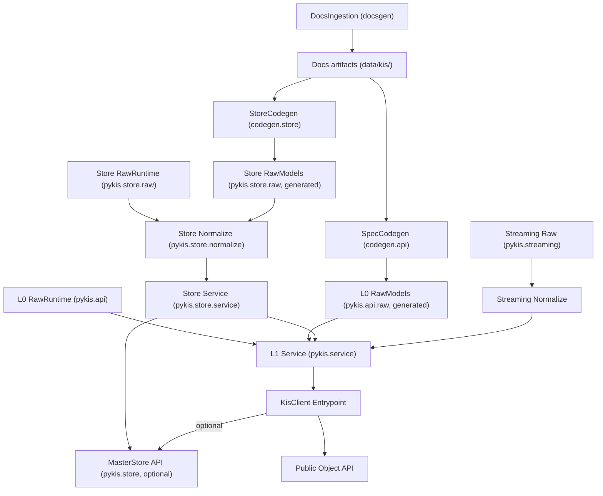

# Layer Architecture (L0 Raw / L1 Service)

## Overview

python-kis는 2-layer 아키텍처로 API 데이터를 처리한다.

```
KIS API Response
       │
       ▼
┌─────────────────────────────────┐
│  L0 — Raw                       │  Generated Pydantic models
│  API 원형 보존                   │  codegen 파이프라인 산출물
│  src/pykis/api/raw/             │  (alias, extra="ignore")
└─────────┬───────────────────────┘
          │
          ▼
┌─────────────────────────────────┐
│  L1 — Service                    │  통합 도메인 모델 + 서비스 로직
│  Type System (YAML)             │  → 통합 enum, 모델 스키마
│  Service Modules (Python)       │  → 매핑, 오케스트레이션, enrichment
│  src/pykis/service/             │
└─────────┬───────────────────────┘
          │
          ▼
┌─────────────────────────────────┐
│  Public API                      │  KisClient / KisAsyncClient
│  src/pykis/client/              │
└─────────────────────────────────┘
```

## Target Layering Map



## Layer 0 — Raw

- **Input**: KIS API 문서 → codegen 파이프라인
- **Output**: 국내/해외 분리된 Raw 모델 + Raw Client
- **Principles**: API 원형 보존, alias/extra 처리만, 형상 통합 없음
- **Location**: `src/pykis/api/raw/` (generated) + `src/pykis/api/` (runtime: auth, client, token)
- **Consumer**: Raw 접근이 필요한 고급 사용자

## Layer 1 — Service

기존 L1(Normalize) + L2(System) 통합 (ADR-012 참조).

- **Goal**: 국내/해외 통합 + 도메인 로직 (multi-call, computed properties, enrichment)
- **Input**: Layer 0 raw 모델 (codegen으로 자동 생성)

### A. Type System (YAML, 선언적)

YAML이 정의하는 것 — **"what"** (모델이 무엇인지):
- 통합 enum 정의 + L0 코드 양방향 매핑
- 모델 필드 정의 (name, type, required, description)
- 필드 출처 메타데이터 (어떤 L0 필드에서 오는지)

Location: `data/service/`

### B. Service Modules (Python, 절차적)

Python이 담당하는 것 — **"how"** (어떻게 변환하는지):
- 변환 로직
- Multi-call 오케스트레이션
- Computed properties
- 조건부 라우팅 (exchange.is_domestic)
- Protocol-based mapper (L0 모델과 디커플링)

Location: `src/pykis/service/`

### C. Drift Detection

L0 변동 시 L1 정합성을 유지하기 위한 시그니처 기반 감지 시스템:
- `scripts/check_l0_drift.py` — 시그니처 비교 스크립트
- `data/service/_l0_manifest.yaml` — 기준 시그니처 매니페스트
- `.pre-commit-config.yaml` — 커밋 게이트 (l0-drift-check hook)

## Access Tiers

| Tier | Layer | API | Use Case |
|------|-------|-----|----------|
| 일반 사용자 | L1 | `KisClient` / `KisAsyncClient` | 대부분의 사용 |
| 고급 사용자 | L1 직접 | Service 모델/함수 직접 접근 | 커스텀 처리 |
| Raw 접근 | L0 | `KisRawClient` + Raw 모델 | API 원형 필요 |
| Streaming Raw | L0 | `pykis.streaming` L0 API | 실시간 원시 구독 |
| Store 접근 | 보조 | `MasterStore` (optional) | 종목 조회 |

- L1 API는 기본 경로, raw 접근은 명시적 경로로만 허용
- 필요 시 L1 응답에 raw payload 첨부 debug 옵션 제공 (기본값 off)

## Dependency Rule

상위 레이어는 하위 레이어에만 의존. 역방향 의존 금지.

```
L1 → L0 (allowed)
L0 → L1 (forbidden)
```

## Traceability

```
KIS Endpoint → Raw Model (L0) → Service Model (L1) → Public API
```

Each layer transformation is deterministic and traceable.

## Streaming Layering

동일한 layer 원칙을 스트리밍에도 적용 (상세: `streaming.md`):

- **L0**: WebSocket transport, 인증/세션/구독/복호화. Decimal/UTC 변환은 L0에서 수행.
- **L1**: 국내/해외 이벤트 형상 통합, 표준 필드명, 비즈니스 규칙

기본 사용자 경로는 L1을 사용하며, raw 접근은 명시적 L0 API로만 제공.

## Store Layering

마스터 데이터(종목정보)에도 동일 원칙:

- **L0 (RawStore)**: `codegen.store`가 `data/kis/종목정보파일`을 읽어 생성.
- **L1 (MasterStore)**: `pykis.store.service` + `_async/_sync` backend. 국내+해외 통합 정규화 레이어로 제공.

## Rate-Limit Policy

KIS FAQ 기준 (2025-04-28):

| Type | Limit | Scope |
|------|-------|-------|
| REST (real) | 20 req/sec | 계좌(앱키) |
| REST (demo) | 2 req/sec | 계좌(앱키) |
| WebSocket | 1 session | 계좌(앱키) |
| Subscriptions | 41 total | per session |

설계:
- REST: per-second token bucket rate limiter
- 429 수신 시 `Retry-After` 반영 대기 후 재시도
- WebSocket: `SessionPool` + `SubscriptionRegistry` (ADR-004)

## Client Entrypoint

- `KisClient` (sync) / `KisAsyncClient` (async) — ADR-001
- Composition: API + L1 service + optional streaming/store
- Init flags: `enable_streaming: bool = False`, `enable_store: bool = False`
- Lifecycle: explicit `aclose()`/`close()`
- GC discipline: `WeakValueDictionary` for handles, weakref for client refs
