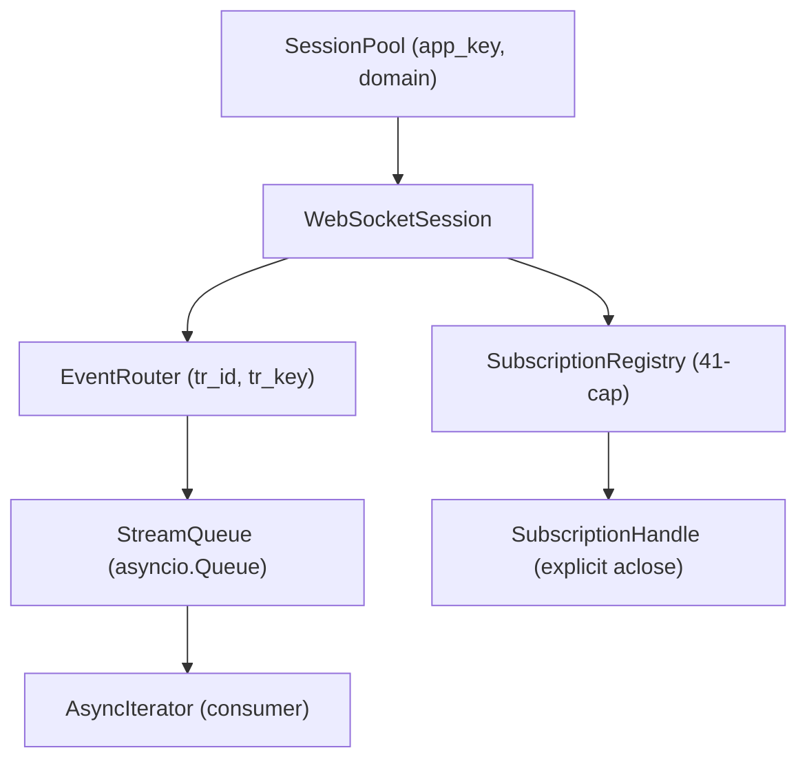

# Streaming Architecture

## Overview

Async-first WebSocket 스트리밍. appkey-shared 세션, Layer 0/1/2 분리.

## Components

### SessionPool

- `(app_key, domain)` 키로 1 세션만 유지
- 참조 카운트 기반 공유
- domain: `demo` / `real`

### SubscriptionRegistry

- 41-subscription cap 강제
- 명시적 subscription handle 관리
- `aclose()` 기반 해지 (GC 의존 없음)

### EventRouter

- `(tr_id, tr_key)` 키로 이벤트 라우팅
- per-subscription `asyncio.Queue` 연결

### StreamQueue

- Bounded queue with backpressure
- Drop-oldest for high-frequency data
- Latest-only for quote data

## Layering

### Layer 0 — Raw Transport

- WebSocket connect/send/receive
- AES-CBC decryption (key store)
- Control message handling (subscription confirm, key update)
- `StreamingSession`: subscribe/unsubscribe

### Layer 1 — Normalize

- 국내/해외 이벤트 형상 통합
- 표준 영어 필드명 정규화
- Decimal/UTC 변환

### Layer 2 — System

- 비즈니스 규칙 적용
- 파생 필드 계산
- 사용자 레이어 이벤트 모델

## Reconnect Flow

1. Connection loss 감지
2. Exponential backoff 재연결
3. Active subscriptions deterministic replay
4. Encryption key 갱신
5. 41-cap 재검증

## Market Timezone

해외 종목 키 포맷: `D{MARKET}{SYMBOL}` 또는 `R{MARKET}{SYMBOL}`

시장 코드 추출 → `MARKET_TIMEZONES` 테이블로 IANA timezone 매핑 → UTC 변환.

## Rate Limits

| Type | Limit | Scope |
|------|-------|-------|
| REST (real) | 20 req/sec | 계좌(앱키) |
| REST (demo) | 2 req/sec | 계좌(앱키) |
| WebSocket | 1 session | 계좌(앱키) |
| Subscriptions | 41 total | per session |
